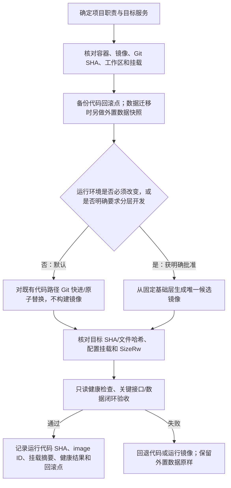

# 全系统职责与 Docker 发布、持久化、回滚规范

适用范围：`pyQuant3/stock_standalone`、`InStock`、`stock-strategy` 及其桌面端、Go/Web 服务和 Docker 运行环境。本文是跨项目总则；各项目的操作手册继续维护自己的路径、服务名、健康检查、锁和现存挂载清单，不能用总则替代现场核验。

## 1. 项目职责与数据边界

| 项目/组件 | 主要职责 | 权威数据与边界 |
|---|---|---|
| `pyQuant3/stock_standalone`（总控工作区） | 维护 TK、ATS 桌面端及跨项目接口；统筹版本、配置、联调和验收；确保各项目手册一致 | 是联动方案与本地开发的协调入口，不代表 Docker 现网状态；现网状态必须由对应主机与容器实时核验 |
| `stock-strategy` | PVE/LXC 中的 Go API、SBC/Web 和 Python 行情任务；聚合题材、人气热度、连板天梯及共享联动状态 | 服务端共享事实与 API 的主要归属；不代替桌面本地关注管理，不直接改变 TK/ATS 交易准入、风控或执行 |
| `InStock` | Python 选股、基本面/历史特征、候选筛选及其 Web/API 与定时数据任务 | 负责候选与历史/基本面证据；盘后候选不能冒充盘中实时热度，也不负责交易执行 |
| TK | Windows 桌面主控、重点关注、实时行情/竞价监控、本机 JSON 联动网关和本地 IPC 适配 | 对本机已接受的关注状态及 TK 实时显示负责；不把网络命令直接等同于已保存或已消费 |
| ATS | Windows 分析终端、龙头/资金、连板天梯、新股次新、异动分析及证据消费 | 对 ATS 自有分析结果和 UI 消费负责；共享证据不自动成为策略指令或交易指令 |

联动主链按已审核契约运行：`SBC/Web → stock-strategy Go → 桌面 JSON 网关 → 本机关注管理器 → TK/ATS`。InStock 提供筛选候选和历史特征；TK/ATS 发布各自的竞价、异动、龙头、天梯和新股证据。每条共享证据保留来源、时间、交易日、revision/新鲜度；来源缺失或过期必须显示为缺失/陈旧。职责表说明数据归属，不表示当前 S1–S4 所有场景均已验收通过；完成状态以最新全系统验收记录为准。

## 2. Docker 默认发布原则

- **默认 Git 版本一致性更新，不构建新镜像、不新增镜像层。** 以明确审核的 Git commit SHA 为发布版本，在项目既有代码路径/既有最新运行层中快进更新或原子替换；保留现有容器配置、网络、端口和挂载结构。代码更新若必须重建容器，先证明目标代码在重建后可从既有 Git 源或现有持久路径恢复。
- 发布前检查当前 image ID、容器配置、挂载清单、代码分支/HEAD/工作区差异和回滚点。工作区不干净时先备份并逐项核实；禁止用 `reset --hard`、`clean` 或盲目 `pull` 覆盖未提交修改。默认只允许明确目标的 fast-forward。
- 普通功能、策略、页面、定时脚本或全系统联动代码更新，不因“改动多”自动构建镜像。全系统联动可使用已明确批准的隔离开发层进行阶段验证；合并/验收后以 Git 版本为准，不为每个后续修复再复制一层。
- 只有运行系统、基础依赖、原生库、安全补丁等确实需要改变不可变运行环境，或用户明确要求隔离分层开发/候选镜像时，才进入构建例外。例外必须写明原因、目标基础镜像 digest、源码 SHA、输出标签、预计层数、外置数据清单、回滚镜像和验收门槛；每次从批准的固定基础层或指定最新层产生一个唯一候选，不串接无界历史层。
- 不使用 `docker commit` 固化临时运行状态；压平不是源码同步手段。禁止全局 `docker system prune`、`docker image prune -a`、`docker volume prune`；只可按核对后的精确清单清理未被当前/回滚容器引用的镜像。

### 默认发布流程

### 镜像说明、标签与版本识别

- 每个新建的基础/候选镜像都应有 OCI 说明：`org.opencontainers.image.title`、`description`、`version`、`revision`，并标记项目、镜像角色（`base`/`runtime-candidate`）、固定基础 image digest、发布模式、既有外置数据契约及回滚方法。标签要区分“运行环境版本”和“镜像内实际源码版本”。
- 镜像是不可变对象。对运行容器内做 Git 更新不会改变 image 标签、digest 或 image size；**禁止为了更新说明标签而重建业务镜像**。此时以 `docker inspect` 读取运行镜像身份/标签，以容器内 `git rev-parse HEAD`（或项目的 release manifest）读取实际应用代码 SHA。镜像标签中的 `revision` 只说明镜像构建时包含的 revision，不能宣称代表之后热更新的代码。
- 只有在本来就获准构建新镜像时才写入/更新标签。使用唯一、可读的项目和版本 tag；禁止把同一标签静默指向不同 digest。每次发布记录 image digest 与 Git commit 的映射。
- 分清体积指标：`docker image inspect` 的 image size 是镜像；`docker inspect --size` 的 `SizeRw` 是容器可写层；`docker ps -s` 的虚拟大小约为 image 加可写层。镜像列表各行还可能共享层，不能直接累加成磁盘占用。必须保存更新前后的字节数；不能把虚拟总大小误报成新镜像大小。

### 外置持久化与无损回滚

- SQLite/数据库、WAL/SHM、HDF5、历史行情、缓存、运行日志、动态状态和必须跨容器生命周期保留的配置/任务状态，必须落在项目已登记的外置持久化路径。外置源代码目录若已配置，其目录结构、目标路径和挂载关系均按现有契约保持不变。
- 每项目的 `docker inspect .Mounts` 清单是运行契约。发布不得新增、删除、重定向或改名挂载，不改容器端口、网络、运行参数或容器名来绕过发布门槛。若发现必须保存的运行数据仍写入容器可写层，先备份并把该路径列为阻断问题，不得直接重建/删除容器。
- 代码回滚与数据回滚分离：先回到上一已验收 Git SHA 或逐文件代码备份；只有运行环境确有变化时才恢复上一 image，并按原挂载清单接回同一外置数据。普通代码回滚不恢复旧数据库，避免抹掉发布期间的新数据。数据库 schema/data migration 另设快照和兼容回退方案。
- 删除容器不得带 `-v`；禁止删除外置目录、卷或同盘唯一备份。重大故障回滚前确认外置存储挂载正常、文件系统可读写和备份校验通过；回滚完成后复核数据文件 hash/行数/最新交易日以及服务健康。

## 3. 各项目执行附加条件

- **InStock：** Python 源码 Git 位于容器现有 `/data/InStock`；只有 cache、strategy、forwardp、log 等手册列明的子目录是外置挂载，不能把“部分源码/数据外置”理解成整个仓库都在宿主机。日常默认在现有容器中快进到审核 SHA；不重建容器、不改变四个挂载。`trade_time.py` 等未挂载源码更新会增加容器可写层，需记录 `SizeRw`，但不会增加 image size。
- **stock-strategy：** 行情库与运行数据使用现有外置挂载；Go/Web 当前发行物在只读根文件系统的镜像中。当前 `build-and-deploy.ps1` 是显式分层镜像发布入口，不是默认 Git 热更新器。现有 Go/Web 部署若没有经过验证的无镜像 Git/发行物替换入口，不得把分层脚本误称为默认模式；入口适配完成前，常规 Go/Web 发布属于工具链缺口，只有用户明确选择当前全系统联动隔离分层验证时才可走该例外。宿主机 Python 定时源按其现有 Git 路径单独同步，不代表 API/Web 镜像已更新。
- **TK/ATS：** 是 Windows 原生开发/运行程序，不属于 PVE Docker 镜像。其发布按本机 Git、Python 环境和桌面 UI 线程/IPC 手册执行；Docker 发布不得替代或修改桌面交易风控、执行链。

## 4. 发布记录最小字段

项目/服务与职责、操作者和时间、目标 Git SHA、工作区是否干净、更新前后文件清单/哈希、image tag+digest+标签、容器 ID 与 `SizeRw` 前后字节数、完整挂载摘要、外置备份路径及校验、健康/业务验收结果、回滚 SHA/image/命令及回滚结果。不得记录密钥、令牌或完整环境变量。
