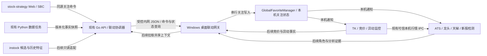
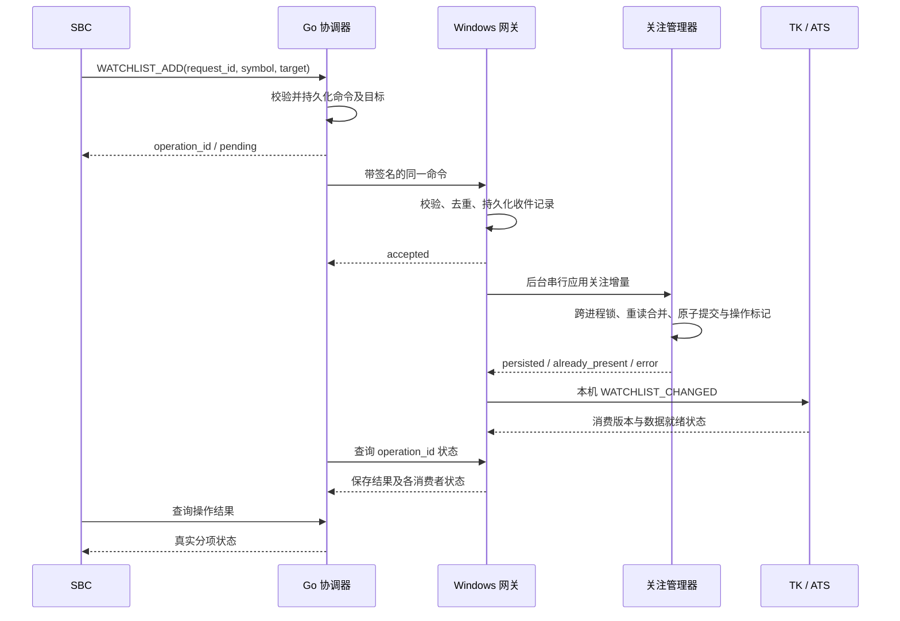

# 全系统数据与重点关注联动：设计审核方案

- 日期：2026-10-10，Asia/Hong_Kong。
- 状态：仅设计、静态审核；未实施、未启动服务、未连接实盘、未部署。
- 审核结论：**架构有条件通过**。优先复用 stock-strategy 的题材与连板能力、TK 的竞价与实时监控、ATS 的分析终端；实施前须关闭本方案列出的协议、并发持久化和行为边界问题。
- 第一交付目标：stock-strategy 的 SBC 小图和放大窗口，一键将当前 A 股添加到指定桌面的 TK/ATS 重点关注，并展示真实的保存与同步结果。
- 后续目标：热度榜、趋势题材、短线连板、TK 竞价、ATS 龙头/天梯/新股次新检测、异动跟踪共享证据和身份，形成可追踪的联动链。

## 1. 设计决策

1. **stock-strategy 承担题材与连板事实的聚合中心**，保留 Go API 和现有 Python 数据任务；TK、ATS 通过适配器接入。
2. **同机沿用现有 IPC，跨机新增受控 JSON 联动入口**。不把现有 pickle 行情端口或 Windows 命名管道直接改成对内网开放。
3. **cct 增加内网绑定配置**。新联动入口默认选择本机可达的内网地址，监听地址、对外公布地址、远端连接地址分别配置。
4. **重点关注、行情订阅、策略评估、交易执行分别确认**。新增关注沿用现有监控规则，远程命令本身不能携带买卖、风控或执行开关。
5. **先展示共享证据，再验证联动评分**。各模块保留已有分数与角色，不在首期用新综合分替换策略决策。
6. **分阶段统一状态**：第一期中央保存命令及结果，桌面关注清单仍由本地管理器负责；后续需要双向同步时，再引入带来源和版本的中央关注状态。

## 2. 已核实的实现及边界

以下为本地源码观察；部署记录仅作为拓扑背景，不代表本次核验了生产运行状态。

| 模块 | 已有能力与证据 | 对本方案的意义 |
|---|---|---|
| 当前 Web 工作台 | `stock-strategy/source/README.md:60` 区分上游前端与集成前端；实际集成前端为 `easy-stock-web` | SBC 按钮应接入集成前端，避免改错 `easy-stock-analysis/frontend` |
| SBC | `easy-stock-web/src/components/KLineExplorer.tsx:14` 共用小图/放大窗口控制；`KLineChart.tsx:81` 复用 Explorer；Go 路由见 `server.go:569` | 关注操作放入共享图表操作区，复用一个请求和状态入口 |
| 题材 | Go `/api/v1/themes/overview`、`/themes/screen`、`/sector-map`，见 `server.go:590`；`foundation/types.go:218` 有题材强度、主线、龙头和日期字段 | 不需要在 TK/ATS 再独立重建题材底座 |
| 短线连板 | `/api/v1/short-term/limit-up-ladder`，见 `server.go:593`；`limit_up_ladder.go:19` 有连板、首次封板、炸板、主次题材、来源等 | 可提供天梯结构、题材归属和高度证据 |
| 人气热榜 | `/api/v1/stocks/hot-ranks`，见 `server.go:609`；`stock_hot.go:16` 保留分源排名与共识分；`providers/hotstock/client.go:93` 为同花顺，`:131` 为东方财富 | 人气排名是独立维度；当前缓存 TTL 为 2 分钟，见 `server.go:361` |
| stock-strategy Python 数据任务 | `easy-stock-service/yidong.py:1` 汇总涨停池、人气、异动；`sector_leader.py:693` 有板块四维确认 | 可补充异动和板块证据，但任务输出不能直接等同于统一实时 API |
| instock | `instock_data_fix/job/streaming_scan.py:16` 批次扫描，覆盖校验后发布；`web/web_service.py:47` 为既有 Web/API 路由 | 作为筛选候选与历史特征来源，不能把盘后结果冒充盘中热度 |
| TK 重点关注 | `global_favorites.py:398/416/446` 支持单股/批量添加和删除；`instock_MonitorTK.py:11196` 触发刷新 | 业务方法可复用；本次未定位到已定义的远程增删关注命令协议 |
| 同机关注同步 | `global_favorites.py:17` 使用独立关注文件；`:109` 重载防抖 3 秒、`:113` 每 2 秒监听 | 跨进程共享依赖实际配置路径一致；跨机器不能靠此文件自动贯通 |
| 既有控制 IPC | `data_utils.py:22` 为 `\\.\pipe\instock_tk_pipe`；TK `:3297` 监听控制；`:3504` 的 `ADD_MONITOR` 只写附加监控代码 | `ADD_MONITOR` 不等于重点关注；所查调用范围未见该列表进入采集入口，需另验 |
| 行情 IPC | `ipc_sync_manager.py:35` 注册 26668/26670/26671/26675；`:282` 本地绑定、`:329` pickle 解包；ATS `ipc_bridge.py:63/203` 同类逻辑 | 继续作为可信本机数据面；新 JSON 联动面独立版本化 |
| 现有 HTTP 联动 | `sys_utils.py:1524` 起处理名称查询与 `/link`；`:1576` 监听本机 26672 | 当前没有重点关注写入路由，也没有面向内网写操作的鉴权边界 |
| TK 板块与竞价 | `sector_focus_engine.py:528` 的 SectorFocusMap、`:616` 注入 detector 板块、`:2420` 的 Controller | TK 已有板块能力；缺口是与其他底座共享身份、时间和证据 |
| ATS 板块与龙头 | `ats/sector_data_aggregator.py`、`ats/hot_sector_engine.py`、`ats/ui/capital_dragon_panel.py`、`ats/ui/dragon_monitor.py` | 保留已有聚合与量价评估，新增外部题材上下文，不整体重写 |
| 天梯与新股检测 | `ats/ui/daily_limit_up_dialog.py`；新股 `ipo_subnew_detector_dialog.py:564` 订阅 26675；`ipo_detector_ipc.py:25` 管理本机生命周期文件 | 新股接入已有消费者和 UI 线程；生命周期文件不作为跨机协议 |
| 异动与状态总线 | `next_day_anomaly_watch.py:786` 补充板块证据；`market_state_bus.py:50` 发布本进程快照；`signal_bus.py:105/132` 提供事件及外部队列桥 | 可用作本地适配点；这些单例本身不构成跨机器消息总线 |

stock-strategy 部署交接记录说明 Web/API 位于 PVE/LXC 的 Docker 环境；其中 `127.0.0.1` 指容器自身，无法指向 Windows 的 TK/ATS。第一期设计假设 TK 与 ATS 在同一 Windows 桌面、使用同一个关注配置路径；不同桌面通过不同 `node_id/workspace_id` 显式选择。

## 3. 审核发现与实施门槛

| 优先级 | 发现、影响 | 设计处理 |
|---|---|---|
| 必须处理 | 现有 pickle 接收端没有面向内网的认证边界；`IPCSyncManager._handle_client` 也不能承担有界 JSON 网关职责 | 只在新入口开放内网 JSON；原端口保持本机，禁止直接代理未知 pickle 字节 |
| 必须处理 | `global_favorites.py:295` 全集合写盘，`:335/336` 先删除再改名；进程内锁不能避免 TK/ATS 并发覆盖 | 全部关注写者采用跨进程互斥、重读后合并增量、原子替换和持久化结果确认 |
| 必须处理 | `save_to_config` 捕获错误，原有添加方法没有明确成功返回；内存版本先增加，不能据此承诺已保存 | 网关使用新增内部结果接口，区分提交成功、写入失败和结果待核验；保护旧方法签名 |
| 必须处理 | 关注会影响监控：ATS `main_window.py:143` 让关注股进入结构评估，`universe_manager.py:463` 保留观察池；TK `:23012` 可补入 V-Reversal 池，实时服务 `:5343` 可预热 | 一键关注的效果按现有业务验收；不得宣称它仅改变高亮，也不得将其直接升级为交易指令 |
| 必须处理 | ATS `main_window.py:7695` 休市关注轮询为 60 秒；新增关注缺行情时，`favorite_panel.py:169` 有 0 值占位 | 新增即时本机通知，并把新联动的行情缺失显示为待获取；保存、显示、行情就绪分开回执 |
| 后续接入前处理 | `hot_sector_engine.py:175` 的单值代码到板块映射会覆盖多题材关系；aggregator 存在经典中军库和别名兜底 | 新建多对多题材上下文，标明真实成分与兜底来源；保留旧主板块字段兼容 |
| 后续接入前处理 | 热榜汇总使用最新来源时间；部分来源缺失不能代表全榜新鲜。`use-theme-minutes.ts:6` 最多取 16 只当前页样本，分钟影响由前端计算 | 保留每源日期、覆盖率和错误；样本关系不能直接充当全板块带动力 |
| 后续接入前处理 | Python `yidong.py:95` 的涨幅 ≥9.5% 是兜底候选，非全部市场涨停事实；`sector_leader.py:749` 直接取未排序 ranked 首项，和“涨幅最高”注释不一致 | 先作为候选证据，禁止传播为已确认封板/权威龙头；相应适配前单独修正并验证 |
| 后续接入前处理 | 既有 Go 鉴权允许 token 为空，见 `httpapi/auth.go:23`；WebSocket 当前只是 quotes 定时推送，见 `stream.go:33` | 新写接口必须单独要求有效鉴权；不把行情 WebSocket 当成已有可靠命令总线 |

这些发现基于静态阅读，未做漏洞利用、故障注入或实盘复现。它们是新联动的门槛，不扩大为本次代码修复任务。

## 4. 拓扑与方案比较

| 方案 | 评价 |
|---|---|
| 所有 127.0.0.1 统一替换为 0.0.0.0/内网 IP | 无法解决命名管道、回调地址、pickle、回执、同端口多机身份；不采用 |
| 浏览器直接调用 Windows 26672 | 受到浏览器来源、HTTPS/HTTP 和本地网络访问策略影响，且现接口不支持关注命令；不作为正式主链路 |
| **Web → Go → 桌面 JSON 网关 → 现有管理器** | 复用 Go 鉴权、Windows IPC 和业务方法；可确认结果、管理多桌面，作为首选 |
| 桌面主动向 Go 拉取命令 | 可解决中心无法访问桌面的网络限制；保留为网络验收失败后的传输替代，不在首期同时实现两套 |

首期网关挂在 TK 主进程生命周期中，网络线程和持久化 worker 不占 UI 主线程；TK 未运行时由 Go 展示桌面离线。ATS 独立运行且 TK 长期关闭的模式，后续再将相同网关抽为独立桌面服务，不提前引入常驻守护程序。

## 5. 第一阶段：SBC 一键添加重点关注

### 5.1 用户操作与结果

- 首次选择目标桌面，例如“主桌面：TK + ATS”；之后 SBC 操作区显示 `⭐ 加入重点关注`，保留目标桌面标识。
- 点击时固定当前 `symbol + market + 图表上下文 + 目标桌面`；随后切股不改变已提交的标的，旧请求结果不能覆盖新标的状态。
- 小图与放大窗口共用操作状态；请求进行中禁用重复点击，网络重试沿用同一 `request_id`。
- 已在本地关注集合中的股票返回 `already_present`，保留最初关注日期；返回的原因/题材保存在联动元数据，不覆盖既有日期。
- 反馈分别显示“已保存”“TK 已同步”“ATS 已同步/未运行”“行情待获取”；仅收到 HTTP 202 时显示“已接收，等待处理”。
- 首期仅添加；不自动把热榜全量转为重点关注，也不在断线重连时覆盖整个本地清单。远程删除在后续来源模型完成后开放。
- 历史/陈旧图表仍可手动关注，但显示其实际数据日期；关注行为不能让旧行情变为实时有效行情。
- 初始支持经证券目录确认的沪深 A 股。北交所按目标 capability 单独验收；港美股、指数、基金等不支持时明确拒绝，不截断代码混入 A 股。

### 5.2 业务链路

同一机器、同一配置路径只应用一次关注写入，TK/ATS 分别报告消费结果；不同机器各自独立应用，允许部分成功，不承诺跨桌面原子事务。一个目标失败时不撤销另一个目标已完成的人工关注。

### 5.3 最小命令与回执契约（拟新增）

首期拟新增以下入口；这些路径当前不存在。

| 入口 | 责任与调用者 |
|---|---|
| `GET /api/v1/linkage/targets` | Go 返回已配置桌面的能力与就绪状态，供 Web 选择 |
| `POST /api/v1/linkage/commands` | Web 向 Go 提交关注命令；鉴权后持久化并返回操作 ID |
| `GET /api/v1/linkage/operations/{id}` | Web 查询各目标结果；访问者只能查看获授权 workspace 的操作 |
| `POST /bridge/v1/commands` | Go 向桌面提交已签名命令，先持久化收件再返回 accepted |
| `GET /bridge/v1/operations/{id}` | Go 查询桌面提交结果及各本机消费者状态，同样要求签名 |
| `GET /bridge/v1/health` | 最小存活探测；详细能力、版本和配对状态仅向认证对端返回 |

| 字段 | 约束 |
|---|---|
| `schema_version / type` | `1 / WATCHLIST_ADD`；使用“确保添加”语义，不使用 toggle |
| `request_id / operation_id` | 点击级幂等 ID、服务端操作 ID；同 ID、不同正文返回冲突 |
| `workspace_id / target_node_ids` | 只选已登记、授权的目标；不能由浏览器提交任意主机 URL |
| `symbol / instrument_type` | 例如 `600733.SH / stock`；经目录确认后再转换本机六位代码，保留前导零与交易所 |
| `source / reason / context_refs` | `stock-strategy.sbc`、关注理由及来源快照引用；限制长度，不能作为可执行文本 |
| `observed_trade_date` | 图表或证据所属交易日；与命令创建日期、原关注日期独立 |
| `created_at / expires_at` | 带时区时间；初始命令有效期建议 5 分钟，过期未应用的命令不执行 |
| `consumer_status` | 分别报告 TK/ATS 的运行、已消费关注版本、显示、行情就绪状态 |
| `error` | 稳定错误码、可重试标志、脱敏说明；不返回 traceback、密钥或磁盘绝对路径 |

命令状态：`pending → accepted → applied / already_present`，或 `rejected / expired / failed`。`timeout` 是调用方尚未查明结果，不能自动视为失败重建新命令；显示状态与命令提交状态独立。

- Go 先持久化再发送；桌面先落收件记录再确认 accepted；应用完成后才能报告 applied。
- 首期 Go 使用既有 SQLite 能力，在现有外置数据目录下独立的 `linkage.db` 保存目标、命令和回执，由 Go 单写；桌面收件账本使用 Python 标准库 SQLite，本地单写。
- 不通过 SMB 共享 SQLite/HDF5/关注文件；不修改既有行情库与交易账本。新增联动库须纳入原有数据挂载与备份核对。
- 关注集合与“该操作已提交”标记同次原子保存；进程崩溃后先查提交标记再恢复收件结果，避免旧命令把后来手动删除的股票重新加入。
- 新增持久化 `favorites_revision` 作为跨进程回执游标；现有 `GlobalFavoriteManager.version` 是进程内版本，不能直接在 TK/ATS 之间比较数值。
- 所有旧关注写者必须保留新增元数据、使用同一跨进程互斥。仅给网关加锁不够；同一配置路径不混跑未升级的写者。
- 文件提交与收件账本并非一个数据库事务，需明确恢复流程；Windows 占用、磁盘满或校验失败时不能发成功回执。
- 初始回执保留建议 7 天；提交去重标记保留期须覆盖命令重试和崩溃恢复窗口，清理后不得允许旧操作重新执行。
- 操作完成后停止重发；新一次有意添加才生成新操作。网关重启恢复队列，但不根据历史命令持续“维护”一个强制关注集合。

### 5.4 本机状态与线程所有权

- 网关网络线程只鉴权、校验、入有界队列和查询结果；后台串行 worker 执行文件/SQLite I/O。
- `GlobalFavoriteManager` 各修改入口统一在跨进程锁内重读最新状态后应用增量；提交成功再发布内存版本，回执读取提交结果。
- 保留管理器旧方法的同步契约与签名；相关 UI 调用点改由 worker 调用这些方法，并在完成事件中刷新。不能把等跨进程锁或磁盘重试放入 UI 回调，也不能在后台提交未完成时立即刷新并假报成功。
- 采用同目录临时文件、flush/必要持久化确认、`os.replace` 与有限重试；旧文件保持可读，避免先删旧文件造成空窗。
- 本机通知只携带版本和操作 ID。TK 通过 `tk_dispatch_queue`；Qt 通过明确连接到 UI 线程的 signal/slot 消费，不从网络线程操作控件。
- ATS 的消费回执拟通过既有 TK 命名管道新增 `WATCHLIST_CONSUMED` 本机命令汇入网关；通知适配器只构造受控本机消息，不转发外部原始协议。未收到消费者回执时只能报告已保存，不能推断已显示。
- ATS 缺少行情时立即显示关注及待获取状态；后台按现有采集权限补齐，不能伪造 0 涨幅、0 VWAP 或昨日行情。
- 行情预热、V-Reversal 入池和 ATS 观察池容量按原限制执行；关注已保存但采集/入池不足时分项报“待就绪/额度受限”，不抬高配额或清退既有池。
- 不将尚未证实有效的 `ADD_MONITOR` 作为数据就绪依据；实施时须定位真正的采集调度和运行中增量预热入口。
- 新服务在 TK 确认主实例后初始化，避免 Windows spawn 和 import 时重复绑定；退出先停止接收，再有界清理 worker/连接，保留未完成账本。

## 6. cct 与内网贯通

### 6.1 拟新增配置

配置由 `JohnsonUtil/commonTips.py` 的 GlobalConfig 统一读取；沿用 `JohnsonUtil/global.ini` 及现有冻结程序配置解析规则，不另建一套优先级。

| 配置键（拟） | 默认/意义 |
|---|---|
| `linkage_enabled` | 默认关闭；实施验收通过后为指定桌面开启 |
| `ipc_bind_host` | `auto_lan`；用于新的 JSON 联动入口，选择本机内网网卡地址 |
| `ipc_advertise_host` | `auto`；公布给 Go 的可达地址，不把 0.0.0.0 作为连接目标 |
| `ipc_linkage_port` | 暂定 `26676`；只核对了源码注册和相关路径，启用前检查实际端口占用 |
| `ipc_node_id / ipc_workspace_id` | 桌面与关注配置域的稳定身份，不以 IP 或端口代替身份 |
| `ipc_peer_allowlist` | 获准的 Go 主机/网段；不能默认放开整个公网 |
| `ipc_key_file` | 本机受权限保护的配对密钥文件路径；密钥不写 ini、前端、URL 或日志 |
| `stock_strategy_base_url` | Go/Web 的内网服务入口，由部署配置确认；交接记录中的地址不是硬编码默认值 |
| `legacy_ipc_bind_host` | 继续为 `127.0.0.1`，原可信本机 pickle 数据通道使用 |

这里“本地外部地址”解释为 **本机在局域网内的地址**，不解释为公网 IP。

- 自动选择先尊重显式网卡/地址；其次采用到已配置 Go 主机的本机路由接口。过滤回环、无效地址，避免直接选择 VPN、Docker、Hyper-V 虚拟网卡。
- 多个等价内网接口无法确定时展示待配置状态；无有效地址时降级为明确标记的本机模式，不悄悄向所有网卡开放。
- `bind`、`advertise`、远端 `base_url` 分开解析；同机可连接回环，跨机使用真实 LAN 地址。不要批量替换代码中的所有 127.0.0.1。
- Go 目标注册表保留 node、workspace、能力、协议版本、已配置地址和最近心跳。多机器相同端口是正常情况，不能继续仅用 port 作为订阅键。
- 对原有依赖客户端 port 回推的行情链路，不做单边跨机改造；后续跨机数据走 JSON 快照接口、完整身份与游标。
- DHCP 变更由同一配对身份更新地址并重新探活；不得自动信任陌生自报地址或广播发现结果。

### 6.2 必要的控制边界

- 浏览器仅访问现有 Go API；新的写接口即使旧配置 token 为空也必须拒绝未鉴权操作。桌面配对秘密只留在 Go 与桌面本地。
- 桌面请求采用逐节点配对的 HMAC-SHA256：覆盖方法、路径、正文哈希、时间戳、nonce 和目标身份；验签、时间窗、重放校验后才进入命令解析。
- 传输重试使用新的时间戳/nonce，但保留相同 request_id、operation_id 与正文；重放保护和业务幂等分别处理。
- 首期只允许 `WATCHLIST_ADD`、状态查询、健康探测；不透传 `EXEC_MACRO`、脚本、交易、窗口句柄或旧控制命令全集。
- 初始建议单请求 ≤64 KiB、批量 ≤100 个标的、固定并发/队列上限；超额返回可识别的限流/负载错误，不创建无限线程。
- 目标地址来自受保护配置；同时校验实际解析地址与允许网段，重定向不得绕过允许列表。
- 可信内网使用配对与访问控制；涉及不可信网络时采用现有可管理的 TLS/VPN 通道。HMAC 只认证与防篡改，不提供保密性。
- 旧 26672 的兼容用途保留本机；新命令入口不沿用其任意来源 CORS 和 GET 改状态方式。新增路由默认不提供浏览器跨源访问。
- 网络验收包含 Docker/LXC 到 Windows 的路由、Windows 防火墙、网卡变更和断线恢复；本次不修改这些配置。

## 7. 后续统一的数据与证据契约

### 7.1 数据所有权

| 对象 | 主提供方 | 消费者与边界 |
|---|---|---|
| 题材身份、成分、短线天梯结构 | stock-strategy Go 聚合已接入来源 | TK/ATS 缓存共享上下文，保留原始来源差异 |
| 人气榜、逐源排名 | Go hot-ranks；Python 异动源补充 | 不能把同花顺从两条链路到达的数据计为两个独立来源 |
| 竞价快照、开盘确认 | TK 的既有竞价/板块检测 | Go 汇总展示，ATS 作为竞价证据；不重新解释成全天行情 |
| 实时量价、VWAP、状态机 | 各模块现有可信采集与分析入口 | 执行继续读取既有收敛入口；外部上下文不覆盖执行用现价 |
| 龙头与结构角色 | stock-strategy 题材/连板 + ATS 资金/通道分析 + TK 竞价 | 角色带 lane、日期和来源；允许同股多角色与判断冲突 |
| 新股次新属性与检测 | ATS 现有新股数据和检测链 | 上市日期/交易日龄明确；热点不能让非新股冒充新股 |
| 筛选候选、历史特征 | instock | 提供 run_id、计算截止日、覆盖情况；失败保留旧快照但标陈旧 |
| 重点关注 | 首期本机管理器；后续中央来源化状态 | 每个桌面为投影；不远程共享文件 |
| 次日候选与异动 | 既有次日候选、TK/ATS 异动引擎 | 保留冻结候选输入，只追加当日证据，避免回放未来数据污染 |

### 7.2 快照字段

- 公共头：`schema_version, source, original_source, snapshot_id, stream_epoch, version, as_of, received_at, trade_date, session_phase, freshness, expires_at, errors`。
- `as_of` 是源数据时间；`received_at` 是接收时间，不能用接收时间翻新旧数据。交易日和交易时段来自各市场日历，休市最近收盘数据明确标为历史/收盘参考。
- 证券身份：`symbol + exchange + instrument_type`，桌面六位代码仅是适配结果；同代码的股票、指数不能混淆。
- 题材身份：优先采用 `provider:board_code`；无代码时用受管理的稳定 ID。名称、别名、父子主题、供应商映射、有效区间和映射版本分开保存。
- 股票与题材使用多对多关系：`theme_id, symbol, membership_source, evidence_time, confidence`；主线/次线是有时间的角色，不覆盖全部所属题材。
- 兜底经典中军、名称模糊匹配、AI 归因分别标记 `membership_kind` 和证据；未经确认不充当权威成分。
- 覆盖信息：`scope, total_expected, observed_count, coverage, complete, is_sample`；当前页、Top N、候选池与全板块必须可区分。
- 数值保留单位及状态：金额为元、成交量为股或明确单位，涨跌幅为百分数；VWAP 是否估算、价格复权方式、周期截止日必须带出。缺失为 null/unknown，不转换为 0。
- 多源数据保留各自 freshness/error/日期；源失效时降低有效覆盖和置信度，不沿用旧排名参与当日共识评分。

### 7.3 传输与恢复

- 第一批共享接口用 REST 全量快照和 ETag/版本拉取；优先复用现有 provider 与缓存，不要求新消息中间件。
- 需要增量后才扩展 `snapshot/delta`；delta 带 `base_version`，接收端只在 epoch、交易日及基线匹配时应用。断档、跨日、重启先请求全量。
- 热榜/题材快照可合并为每主题最新一份；关注命令、来源删除及异动事件不能使用行情的“最新帧覆盖”策略丢弃。
- 事件保留 `event_id, origin_node, causation_id, source_snapshot_ids`，防止 Go→TK→Go 再次包装产生回声和重复证据。
- 本地 `MarketStateBus` 用于状态投影，`SignalBus` 用于业务事件；网关只传允许类型，不假定现有事件队列具备持久化能力。

## 8. 如何解决板块联动与热度跟踪

### 8.1 热度采用可解释的维度，先保留原始量

| 维度 | 显示/跟踪内容 | 来源限制 |
|---|---|---|
| 人气 | 各源排名、排名变化、入榜/出榜、有效源数量 | 比较相同榜单范围和规则；不在 Top N 只表示超出观察范围 |
| 短线结构 | 涨停数量、连板高度、首板、晋级、炸板、梯队完整性 | 真实封板与兜底候选分开；区分不同涨停制度 |
| 趋势 | 当日/五日强度、趋势阶段、活跃天数、结构持续性 | 保留日期、计算窗口和样本覆盖，不当作秒级指标 |
| 竞价 | 板块竞价分、龙头与跟随股、当日确认时间 | 竞价与连续交易阶段分开；前一日竞价只能作为参考 |
| 盘中响应 | 同题材上涨广度、相对强弱、量能扩散、分歧与回流 | 需要足够真实成分和同日样本，缺少覆盖时只显示观察证据 |
| 风险/分歧 | 关键股炸板/走弱、梯队断层、热度退潮、数据失效 | 不直接改止损或触发卖单；作为既有决策入口的附加证据 |

首期不强行合并为一个总分；后续如需共振分，须有 `score_version`、分项、有效覆盖和缺失原因，并通过回放验证。分钟滞后相关性最多称为样本关联证据，不称为因果带动力；不能把当前网页 16 股样本外推到全市场。

### 8.2 统一上下文如何进入各界面

| 界面 | 新增联动信息 | 交互 |
|---|---|---|
| SBC / 趋势题材 / 连板页面 | 关注状态、目标桌面、题材与热度快照日期 | 一键关注；后续显式“在桌面查看”，不因切股自动抢焦点 |
| TK 竞价 | 昨日题材梯队 + 今日热度 + 今日竞价确认 | 按题材聚合关注股，显示一致/背离及各自时间 |
| ATS 资金主线/龙头 | 所属主次题材、趋势/短线角色、人气轨迹、竞价证据 | 本地资金与通道判断保留；角色冲突可见 |
| ATS 天梯 | 统一连板层级、同题材梯队、封板/炸板与数据来源 | 从高标查看跟随与补涨候选，候选身份明确 |
| 新股次新检测中心 | 上市属性与题材热度、同题材龙头、异动时序 | 只在既有合格新股集合内标记共振；不把热榜直接导入交易池 |
| 异动/次日候选 | 触发时的题材、人气、竞价和板块背景 | 显示个股异动与板块响应；原冻结候选不因后见数据重写 |

### 8.3 事件联动规则

- 先实现 `heat.rank_changed`、`theme.phase_changed`、`leader.role_changed`、`auction.confirmed`、`anomaly.detected`、`data.status_changed` 的观察事件。
- 个股异动发生时，按当时有效成员关系补充同题材涨跌、龙头状态和覆盖；不足时标“板块证据不足”，不生成假共振。
- 龙头走强、题材扩散、竞价确认可以形成“共振候选”；龙头走弱但跟随尚强可以形成“分歧观察”。两者都不是下单命令。
- 排名跨阈值与主题阶段变化使用连续快照确认、滞回和冷却；初始阈值经回放确定，不在本方案中修改已有实盘参数。
- 每个 workspace 配置一个联动通知负责人，初期可选 TK；ATS 显示同一事件，避免两套语音重复。故障切换必须显式声明，不让两个进程同时自认主播。
- 原有交易告警不在首期统一接管；只对新增联动事件去重，后续再审查现有 Alert System 与交易日志的整合范围。

## 9. 后续双向关注与删除语义

当需要 TK、ATS、Web 任意入口增删并跨桌面同步时，新增中央 AttentionStore；这是第二阶段的状态治理，不是首期命令账本隐含提供的能力。

- 一条关注保存多来源，如 `manual, sbc, auction, heat, ipo`；自动候选集合与人工重点关注集合分开。
- 本地历史关注迁移为 manual，先导出备份并比对数量/日期；保持现有文件字段兼容。
- 自动榜单退出只撤销该自动来源；存在 manual/sbc 等人工固定来源时仍保留重点关注。
- “取消本来源”与“从所有来源取消重点关注”分开定义；全局删除生成 tombstone 和版本，防止旧快照复活。
- 中央为权威状态分配单调 revision；离线本地操作记录 intent_id 与 base_revision，不靠机器时间做最后写入覆盖。
- 离线新增可合并；涉及同来源增删冲突或全局删除，按中央版本/冲突规则处理并返回结果。旧 intent 不得撤销更新版本的人工操作。
- 每个桌面投影有独立消费游标；同步期间保留持仓、交易日志、既有风控及已完成信号，不把取消关注解释为卖出或删除持仓。
- 关闭双向同步后保留本地已接受的人工关注，不自动还原旧清单。

## 10. 最小实现落点（未来实施清单）

路径以仓库根目录为基准；以下仅为拟改动，不表示本次已修改。

| 文件/模块 | 阶段 | 最小职责 |
|---|---|---|
| `stock-strategy/source/easy-stock-web/src/components/KLineExplorer.tsx` | S1 | 共用关注操作和分项结果，处理切股/放大窗口状态 |
| `stock-strategy/source/easy-stock-web/src/lib/backend.ts` 及拟新增 `lib/linkage.ts` | S1 | 类型、提交、查询、超时与幂等；复用现有 requestJSON |
| `stock-strategy/source/easy-stock-analysis/backend/internal/httpapi/` | S1 | 拟新增 linkage 路由及鉴权；现有 SBC 算法和响应不变 |
| 同一 backend 下拟新增 `internal/linkage/` | S1 | 目标注册、命令账本、HTTP 分发、回执和有界重试；独立于行情 provider |
| `JohnsonUtil/commonTips.py`、`JohnsonUtil/global.ini` | S1 | 新 JSON IPC 的地址、身份和开关配置；不批量迁移全部本机地址 |
| 拟新增 `system_linkage_gateway.py` | S1 | 受控 JSON 入口、签名、收件记录、状态查询、worker 生命周期 |
| `global_favorites.py` | S1 | 兼容原接口的跨进程增量提交、原子保存、操作标记和明确内部结果 |
| `instock_MonitorTK.py` | S1 | 主实例挂载网关、UI dispatcher、运行中关注监控/预热状态 |
| `ats/ipc_bridge.py`、`ats/ui/main_window.py`、`ats/ui/favorite_panel.py` | S1 | 本机关注通知、消费回执和缺行情状态；不改既有交易链 |
| 其余实际调用关注写方法的 TK/ATS UI 入口 | S1 必要兼容核对 | 核对后台提交与完成回调；未完成所有活动写者兼容检查前不开放内网写入 |
| `sector_focus_engine.py`、ATS 板块聚合/UI、异动适配器 | S2/S3 | 发布/消费标准上下文，逐界面显示证据 |
| `stock-strategy` Python 任务与 instock 只读适配 | S2/S3 | 发布有日期/覆盖/状态的候选快照，不共享生产数据库写权限 |
| `tests/` 与 Web/Go 对应测试目录 | 对应阶段 | 下表中的可证伪测试与隔离集成验收 |

不新增 Redis/Kafka，不升级框架或依赖，不重写四套系统。若实施中发现现有 API 无法表达必要状态，优先增加向后兼容字段/新版本入口，另行审核公共契约。

## 11. 分阶段计划与验收

| 阶段 | 可交付结果 | 完成门槛 |
|---|---|---|
| S0：边界冻结 | 配置路径、版本、node/workspace、地址、capability 和关注副作用清单 | 读链路已完成；仍需现场核对实际运行版本、同机配置路径、LAN 路由/端口、真实采集入口；不据历史部署记录视为完成 |
| **S1：一键关注** | SBC → 指定桌面 → TK/ATS，分项回执、离线/超时可见 | 单股/已关注/重试/切股/程序重启/双写/缺行情/额度受限均通过；没有新命令可直接交易 |
| S2：上下文贯通 | 热榜、题材、天梯、竞价在 TK/ATS 共用 ID、来源、日期 | 多题材映射、跨日、部分源失败和排序历史可核验；先只读展示 |
| S3：事件与轨迹 | 主题热度轨迹、龙头/竞价/新股/异动证据联动 | 回放能解释事件原因，断线恢复不重复播报；新增评分先影子运行 |
| S4：双向状态 | 多来源关注、删除、跨桌面投影与冲突处理 | 迁移、离线增删、tombstone、人工固定关注保护通过 |
| S5：策略采纳（另行授权） | 经验证的联动证据供既有唯一决策入口使用 | 先回放/模拟；任何实盘准入、风控或执行变化重新专项审核 |

### 11.1 针对性验证矩阵

| 类别 | 必测场景与结果 |
|---|---|
| 首期正确性 | `000001.SZ` 保留零；指数/港美股不误入；首次关注日期保留；已关注幂等；同 ID 异正文冲突 |
| Web 一致性 | 点击 A 后切到 B，A 回执不覆盖 B；小图/放大窗口状态一致；双击/重复请求只应用一次 |
| 持久化 | TK/ATS 同时增删不同股票不丢更新；同股并发有确定结果；磁盘满/文件锁/提交前后崩溃能恢复且不假报成功 |
| 恢复与网络 | Go/桌面各自重启、ACK 丢失、地址变更、桌面离线、命令过期、已提交后本地删除；旧操作不能重加 |
| 多目标 | 同机共享路径单次应用、不同路径视为不同 workspace；一台成功一台失败分项显示；ATS 未运行仅报告已保存 |
| 安全边界 | 无密钥/坏签名/重复 nonce/过期时间/错误目标拒绝；超大正文和队列满有限响应；命令不能触发宏/买卖 |
| UI 与数据 | 网关不阻塞 Tk/Qt；休市即时关注通知；无行情显示待获取；原监控池配额、策略与持仓行为不被旁路 |
| 快照 | 同源热度去重、陈旧/缺源、多题材、Top N 边界、未知映射、混单位拒绝；delta 断档/跨日先回全量 |
| 异动回放 | 竞价与盘中分段、冻结候选无未来信息、缺板块覆盖不报共振、事件回声和重复语音受控 |
| 原 IPC 回归 | `tests/test_ipc_cold_start_baseline.py`、`tests/test_ipc_trade_rollover.py` 等对应基线/跨日场景；只在实际触及该链路时运行 |

建议首期 LAN 验收目标：在线可写桌面关注持久化 p95 ≤5 秒，已运行界面接收关注版本 p95 ≤5 秒；缺行情/上游失败不计为“行情已就绪”，另外记录等待时间。该数值是待验目标，不是已取得性能；若只能靠旧轮询，不能满足即时同步验收。

更新节奏遵循源能力：当前热榜缓存为 2 分钟，题材/天梯部分缓存 30 秒，分钟关系轮询 60 秒；这些都不等于上游保证同频更新。统一由后台缓存/批量适配供多界面读取，避免每个窗口重复抓取和强刷上游。

## 12. 回滚、未决项与本次交付

- 回滚先关闭新增 linkage 开关、停止新分发/消费；保留人工已接受的关注与操作账本，不自动删除关注、行情数据或交易状态。
- Go 新路由、网关与上下文读取均有独立开关；中心故障时 TK/ATS 保持已有本地运行能力。
- 回滚到不识别新关注元数据的旧二进制前，先备份并核对所有活动写者；不能让旧写者抹掉去重标记后继续重放新命令。
- 尚未现场确认：Windows 实际内网地址/网卡、Docker→Windows 可达性、当前运行二进制版本、TK/ATS 实际配置目录、instock 生产模块路径、各源盘中质量与实际调用负载。
- 尚待实施时定位：运行中新关注的采集/预热调度、ATS 本机控制事件承接、各消费者回执挂点；现有 `ADD_MONITOR` 不能替代这些确认。
- 本次只新增此设计文档；没有修改业务源码、配置、端口注册、数据库或生产部署，没有运行应用、回归测试或实盘链路。
- 本次验证范围：静态调用链、接口/字段/线程归属与协议边界核对；交付前检查文档编码、引用路径和工作区差异。

## 13. 核心源码索引

- [当前工作台与目录说明](../../stock-strategy/source/README.md)
- [SBC 共用操作区](../../stock-strategy/source/easy-stock-web/src/components/KLineExplorer.tsx)
- [Go API 路由](../../stock-strategy/source/easy-stock-analysis/backend/internal/httpapi/server.go)
- [Go 行情元数据和题材结构](../../stock-strategy/source/easy-stock-analysis/backend/internal/foundation/types.go)
- [热榜聚合](../../stock-strategy/source/easy-stock-analysis/backend/internal/httpapi/stock_hot.go)
- [连板天梯结构](../../stock-strategy/source/easy-stock-analysis/backend/internal/httpapi/limit_up_ladder.go)
- [关注管理与持久化](../../global_favorites.py)
- [TK 主控与控制反馈](../../instock_MonitorTK.py)
- [现有本机 HTTP 接口](../../sys_utils.py)
- [IPC 同步管理](../../ipc_sync_manager.py)
- [ATS 行情桥](../../ats/ipc_bridge.py)
- [cct 配置入口](../../JohnsonUtil/commonTips.py)
- [TK 板块与竞价聚合](../../sector_focus_engine.py)
- [ATS 板块适配](../../ats/sector_data_aggregator.py)
- [ATS 热点引擎](../../ats/hot_sector_engine.py)
- [ATS 主界面关注消费](../../ats/ui/main_window.py)
- [ATS 新股次新检测](../../ats/ui/ipo_subnew_detector_dialog.py)
- [次日异动候选证据](../../next_day_anomaly_watch.py)
- [instock 批次扫描](../../instock_data_fix/job/streaming_scan.py)
- [stock-strategy 异动任务](../../stock-strategy/source/easy-stock-service/yidong.py)
- [stock-strategy 板块评分](../../stock-strategy/source/easy-stock-service/sector_leader.py)
- [部署交接记录（历史观察）](../../stock-strategy/ENVIRONMENT_HANDOFF.md)
