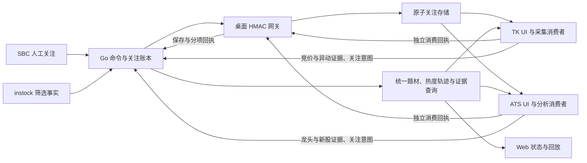

# 全系统联动复审与本地 TK 启用闭环方案

- 时间：2026-10-11，Asia/Hong_Kong；现场只读采样截至 12:42。
- 结论：**本机有效配置的联动总开关已开启；运行链路尚未启用，整体验收仍不通过。** 原有 7 项 P1、6 项 P2 均未关闭，本轮补充 1 项 S3 持续采集缺口。
- 范围：复审当前代码、修改获授权的配置开关、核对运行环境、细化闭环方案。业务源码、交易开关和风控参数均未修改；未重启桌面、部署服务或发送关注增删命令。

## 1. 本轮实际变更

仅修改 [根目录 global.ini:76](D:/MacTools/WorkFile/WorkSpace/pyQuant3/stock_standalone/global.ini:76)：

```diff
-linkage_enabled = False
+linkage_enabled = True
```

- Git 确认配置差异为 1 行增加、1 行删除；ConfigParser 读取 `[general].linkage_enabled=True`，文件为 UTF-8 无 BOM。
- 当前 TK 进程的 `INSTOCK_APP_ROOT` 指向工作区；[get_conf_path:429](D:/MacTools/WorkFile/WorkSpace/pyQuant3/stock_standalone/sys_utils.py:429) 优先读取根目录已有配置，故本轮未修改 `JohnsonUtil/global.ini` 模板。
- [commonTips:1002](D:/MacTools/WorkFile/WorkSpace/pyQuant3/stock_standalone/JohnsonUtil/commonTips.py:1002) 在导入时加载配置并复制标量；[TK 启动入口:7528](D:/MacTools/WorkFile/WorkSpace/pyQuant3/stock_standalone/instock_MonitorTK.py:7528) 在初始化阶段启动网关，未发现现成的联动热加载入口。
- **磁盘开关开启不等于运行进程已启用。** 当前进程没有在本轮重新加载；即使正常重启，现有空配置仍会被网关和上下文客户端拒绝。

## 2. 当前运行状态与接入缺口

| 项目 | 本轮证据 | 判定 |
|---|---|---|
| 主 TK | PID 35252，`instock_MonitorTK.py`，工作目录及 app root 均为本工作区 | 已运行；本轮未重启、未注入运行时配置 |
| 桌面 JSON 网关 | 本机未见 26676 监听；健康请求连接被拒绝 | 未运行 |
| ATS | 进程筛选未发现符合已知 ATS 入口的进程；未做原生窗口枚举 | 不能认定 ATS 已在线 |
| 本机 Go | PID 17032，127.0.0.1:20081 健康返回 200 | 后端已运行 |
| 本机 Go 目标 | 使用该进程已有令牌只读查询，唯一目标为 `tk-dev-local / dev-local`，状态 `configured` | 这是隔离验收登记，不能代表当前真实 TK；`configured` 不证明桌面就绪 |
| LAN Go | 禁用诊断请求代理后，192.168.50.60:20073 健康返回 200；未携令牌的 targets 返回 401 | 服务可达且联动查询受鉴权保护；未核验生产目标清单 |
| 时钟 | API 健康时间与本机请求中点比较，本机 Go 差约 0 秒、LAN Go 差约 +1.1 秒 | 本次采样在签名允许的 60 秒窗口内；尚非持续时钟验收 |
| 发布版本 | [交接记录:102](D:/MacTools/WorkFile/WorkSpace/pyQuant3/stock_standalone/stock-strategy/ENVIRONMENT_HANDOFF.md:102) 登记发布 `20261011114424` | 本轮只验证健康，未据此认定运行二进制与审核源码一致 |

- 最初通用 urllib 探测继承了工具进程的代理而失败，直连后正常；[客户端构造:370](D:/MacTools/WorkFile/WorkSpace/pyQuant3/stock_standalone/system_linkage_context.py:370) 已使用 `ProxyHandler({})`，该诊断现象不是客户端代码缺陷。
- 本轮没有把本机 Go 的开发身份、令牌或测试数据路径复制给真实 TK，也没有查询会生成快照的生产 context 接口。

### 配置接线清单

| 配置 | 当前值 | 下一步配置契约 |
|---|---|---|
| `linkage_enabled` | **True，已完成** | 仅表示允许启动新增联动；运行就绪另行核验 |
| `stock_strategy_base_url` | 空 | 正式候选为已测通的 `http://192.168.50.60:20073`；隔离验收用 20081，不能混用两套状态 |
| `ipc_node_id` | 空 | 固定桌面身份，与 Go 登记完全一致；同一桌面的 TK/ATS 共享桌面身份，不同桌面不得复用 |
| `ipc_workspace_id` | 空 | 与实际 Go workspace 一致；须先读取正式登记，不能推测或沿用 `dev-local` |
| `ipc_bind_host / ipc_advertise_host` | `auto_lan / auto` | 保留现有自动选 LAN 网卡机制；配置 Go 地址后确认选出的地址可被容器访问 |
| `ipc_linkage_port` | 26676 | 本轮未占用；后续核验防火墙、反向路由及健康请求，不改变旧 IPC 端口 |
| `ipc_peer_allowlist` | `[]` | 使用 Go 到 Windows 的实际来源 IP，优先明确 `/32`；不能只按 Web 入口推定 NAT 后来源 |
| `ipc_key_file` | 空 | 桌面独立 HMAC 密钥，至少 32 字节；Go 登记引用相同密钥，秘密不写入报告或源码 |
| `stock_strategy_token_file` | 空；当前 TK 无 `A_STOCK_TOKEN` | 配置受保护令牌文件或既有启动环境；与 HMAC 密钥分开管理 |
| Go 目标登记 | 本机仅有开发目标，生产未知 | 外置 `linkage-targets.json` 明确 workspace、node、Windows LAN URL、密钥路径和 enabled |

- 配置约束见 [网关校验:251](D:/MacTools/WorkFile/WorkSpace/pyQuant3/stock_standalone/system_linkage_gateway.py:251)、[上下文校验:428](D:/MacTools/WorkFile/WorkSpace/pyQuant3/stock_standalone/system_linkage_context.py:428)。当前至少缺少身份、allowlist、密钥、服务地址和令牌，不能靠总开关补齐。
- [Go 目标加载:261](D:/MacTools/WorkFile/WorkSpace/pyQuant3/stock_standalone/stock-strategy/source/easy-stock-analysis/backend/internal/linkage/service.go:261) 发生在服务构造时；[桌面 registration:381](D:/MacTools/WorkFile/WorkSpace/pyQuant3/stock_standalone/system_linkage_gateway.py:381) 只是返回本机描述，没有自动向 Go 注册。修改登记文件后，当前版本需要重新创建 Go 服务实例，不能承诺自动发现或热更新。
- 桌面默认账本为 app root 下 `system_linkage.sqlite3`，TK/ATS 必须指向同一真实桌面数据根；Go 账本、目标文件和密钥必须落入既有外置持久化目录。

## 3. 代码复审结论

- 主仓库 HEAD：`c5d84e45a7a8cb82de128e1772078d78e515775f`；source 仓库 HEAD：`087bf744a0b61f9e1d6191b07fdc81265e394775`。
- 对网关、上下文、补采、关注管理、TK、ATS 主窗/IPC/关注面板、data_utils、commonTips 共 10 份 Python 文件按 LF 规范化后逐字节比较，均与上一轮审核基线相同；Go linkage、HTTP linkage 和 Web linkage 的 HEAD 差异为空。
- 因此上轮反例仍适用；完整原因、代码位置及复现证据见 [上一轮审核](D:/MacTools/WorkFile/WorkSpace/pyQuant3/stock_standalone/docs/tasks/2026-10-11_0043_全系统联动S1-S4实现全面审核与后续计划.md:42)。本轮没有将历史测试结果记为新执行通过。

| 编号 | 优先级 | 当前问题与影响 | 关闭条件 |
|---|---|---|---|
| R1 | P1 | attention 冲突时提前推进消费游标，下一轮可复活远端删除 | 409 后完成远端投影再推进；跨两轮及重启不复活 |
| R2 | P1 | TK/ATS 分连接读改写同一结果 JSON，成功 ACK 可互相覆盖 | 并发 ACK、heartbeat 与重试后，两端状态均保留且不回退 |
| R3 | P1 | 证据全局读取并只按 source_id 合并，跨 workspace 混用、同类桌面覆盖 | 按约定作用域隔离，节点来源和冲突证据可追溯 |
| R4 | P1 | 同日旧数据可标 fresh，断线 Web 不主动降级 | 原始来源有效期、交易阶段和客户端过期判断一致 |
| R5 | P1 | attention 路径绕过完整 A 股目录校验，可新增 ETF 等非目标证券 | command、attention 单条/批量和本地投影执行一致校验；旧项仍可删除 |
| R6 | P1 | 旧 UI 关注入口仍同步等跨进程锁、写盘，竞争时可能冻结 | 活动 UI 写者后台提交并反馈真实结果，批量一次持久化 |
| R7 | P1 | 读到关注文件即可推断 synced，未证明 UI/采集端已消费 | 消费者应用后确认持久版本，排队或刷新失败不能提前成功 |
| R8 | P2 | quote pending、ATS 晚启动和五分钟后补账不能持续收敛 | 命令执行 TTL、消费恢复和行情状态生命周期分开 |
| R9 | P2 | attention 同步依赖 context/events 成功，8 秒客户端与 25 秒聚合超时不匹配 | 关注、上下文、证据上传独立失败边界 |
| R10 | P2 | 快照数量上限先于事件留存到期，历史引用失效，回放入口不足 | 事件保留期内证据可查询，清理不造成悬空引用 |
| R11 | P2 | 核心网关/上下文测试仍被 ignore，Web 状态机覆盖不足 | 必要测试进入版本控制，干净 checkout 可复现构建与回归 |
| R12 | P2 | 多节点串行网络投递，离线目标可能拖慢在线目标 | 有界公平调度，混合节点延迟实测达到门槛 |
| R13 | P2 | 内存 version 与持久 favorites_revision 混用 | 关注版本、行情批次和消费者游标定义明确，重启不回退 |

### R14：持续热度与事件采集依赖客户端读取【P2，新增静态确认】

- [context handler:163](D:/MacTools/WorkFile/WorkSpace/pyQuant3/stock_standalone/stock-strategy/source/easy-stock-analysis/backend/internal/httpapi/linkage_context.go:163) 在 GET 请求期间聚合；[247–253 行](D:/MacTools/WorkFile/WorkSpace/pyQuant3/stock_standalone/stock-strategy/source/easy-stock-analysis/backend/internal/httpapi/linkage_context.go:247) 才派生事件并保存快照。
- [evidence handler:85](D:/MacTools/WorkFile/WorkSpace/pyQuant3/stock_standalone/stock-strategy/source/easy-stock-analysis/backend/internal/httpapi/linkage_evidence.go:85) 只保存来源证据；[服务启动:167](D:/MacTools/WorkFile/WorkSpace/pyQuant3/stock_standalone/stock-strategy/source/easy-stock-analysis/backend/cmd/server/main.go:167) 未启动独立联动快照生产任务，检索未发现其他生产调用方。
- 结果：所有客户端离线时，联动快照/派生轨迹不能持续记录；恢复读取只能比较相隔很久的两帧，不能还原期间热度变化。客户端越多，读取产生的快照越多，还会加剧 R10 的数量清理。
- 后续要求：在既有 Go 服务内明确有界生产任务和来源有效期；查询消费已提交快照，按来源版本或内容变化去重，不引入新消息平台。事件仍须保留交易日、原始时间、作用域和触发证据。
- 验收：全部客户端离线跨过至少两个生产周期，中央仍留存预期快照和变化事件；恢复后可回放且不重复播报。增加客户端不得成比例增加相同快照，也不得突破上游冷却时间。
- 本轮未运行该场景；这是依据唯一生产调用链确认的设计缺口，不冒充动态故障复现。

## 4. 闭环目标与职责



- 一键关注闭环：同一 operation_id 可追踪 Go 接收、桌面持久化、TK 实际消费、ATS 实际消费及行情结果；任一环节失败有独立状态，不能用一个 synced 替代全部完成。
- 双向关注闭环：统一 workspace revision 和来源集合；remove_source 只撤销该来源，remove_all 与离线旧意图冲突有明确规则，人工固定关注不会被榜单退出覆盖。
- 数据闭环：公共行情与桌面证据区分作用域，统一证券身份和多对多题材关系，保留 source、trade_date、as_of、freshness、覆盖率与映射版本。
- 消费闭环：区分 `saved`、`tk_consumed`、`ats_consumed`、`quote_status`、`context_status`、`attention_revision`；此处是待落实的语义清单，不是本轮新增 API 字段。
- 业务闭环：每个业务窗口能解释“所属题材、热度如何变化、判断来自哪里、时间是否有效、与其他来源一致还是冲突”，并能追溯触发时证据。

## 5. 业务接入矩阵

| 业务 | 目前做到 | 仍需落实的具体交付 |
|---|---|---|
| SBC 重点关注 | 共享按钮、Go 命令和桌面保存链已具备 | 真实目标就绪、分项 ACK、离线恢复、双向删除和行情补齐全部验收 |
| stock-strategy 题材/连板 | 已聚合题材、热榜、天梯；成员以龙头样本和涨停池为主 | 有版本的跨源题材映射、多对多成员、覆盖说明；明确人气排名与趋势/短线热度区别 |
| TK 竞价 | 可发布竞价证据，选中股可显示摘要 | 竞价业务视图按题材聚合昨日梯队、今日热度、竞价确认和一致/背离；历史竞价不冒充盘中状态 |
| ATS 龙头/资金主线 | 可发布龙头角色，关注面板可显示上下文 | 龙头窗口消费统一题材与竞价，保留本地判断、同股多角色及冲突；处理单值 code_to_sector 覆盖 |
| ATS 天梯 | 共享上下文已有连板层级 | 天梯业务窗口显示同题材梯队、封板/炸板时间、来源及跟随候选，并支持主动筛选/跳转 |
| ATS 新股次新 | 独立分析可发布 IPO 证据 | 在合格新股 universe 内显示题材/热度/竞价背景，明确补采行情与检测器输入的关系 |
| instock | TK 15:30 选股完成后有候选发布 hook | 核对真实生产 selector 入口，覆盖其他批次、人工选股、空结果和增量；不能以单个 hook 宣告底座全部接入 |
| 热度轨迹与异动 | 已有部分变化事件和信号发布 | 独立持续生产、时间序列、覆盖变化、冷却/滞回、持久去重与触发时证据回放 |

- 保留现有 TK/ATS 策略和分析引擎；先落实证据消费与只读展示。行情补采 sidecar 不等于已加入新股检测或实盘策略输入，不能在验收中混为一项。
- 板块联动不以“同屏几个摘要标签”为完成标准；每个窗口须通过多题材、缺源、冲突、跨日和断线场景。

## 6. 后续工作包与放行顺序

| 顺序 | 组件责任与交付 | 放行门槛 |
|---|---|---|
| W0 已完成 | 本轮复审、有效总开关开启、运行状态与接线清单、14 项问题登记 | 仅放行配置准备，不宣告全链路启用 |
| W1 配置准备 | 桌面/部署维护方核对正式 targets、身份、数据根、密钥路径、allowlist、两向路由与版本 SHA；先形成可审阅配置清单 | 实际值一致，秘密独立保管；隔离验收与真实关注集合严格区分 |
| W2 正确性修复 | Python/Go 先关闭 R1、R2、R5，再关闭 R3、R4；TK/ATS 关闭 R6、R7 | 原 7 项 P1 的反例均转为正式回归，不能靠调整断言通过 |
| W3 恢复与版本 | Go/Web/Python 关闭 R8、R9、R11、R12、R13，明确节点 ready 与静态 configured 的区别 | 干净 checkout 可复现；长断线、迟启动、重启及混合节点均收敛 |
| W4 S1/S4 现场验收 | 先隔离单机 TK+ATS，再双桌面 LAN、容器到 Windows | 保存和已运行消费者消费分别 p95≤5秒；行情等待独立计量，真实状态可追踪 |
| W5 S2 业务贯通 | 统一题材身份与成员覆盖，再依次接 TK 竞价、ATS 龙头、天梯、新股、instock 与异动 | 上表逐窗口演示通过，多来源冲突可解释，不改变交易执行入口 |
| W6 S3 轨迹闭环 | Go/Python/Web 关闭 R10、R14，补热度序列、事件去抖/去重、证据留存与回放 | 客户端离线仍持续留存；事件有效期内证据完整，回放无未来信息 |

- W1 可以继续做配置清单和只读检查；真实关注集合的同步启用依赖 W2/W3。当前配置 True 不构成跳过这些依赖的验收结论。
- 后续编码应按工作包分别形成最小兼容改动；当前交付没有实施其中任何业务修复，也没有替 Luna 编造已完成项。
- 正式启动前正常退出/重启相关桌面，并按静态 registry 的实际生命周期重新加载 Go；本轮没有执行这些运行操作。

## 7. 必须覆盖的闭环验收

| 场景 | 必须成立的结果 |
|---|---|
| SBC 单股新增、重复点击、已关注、切股/切节点 | 请求幂等且归属正确，日期/来源保留，分项结果真实 |
| HMAC 错误、错误节点/工作区、重放、时钟越界 | 拒绝且不写关注；正常签名及实际 Go 来源能通过 |
| 远端删除插入 GET/POST 之间，随后再同步两轮及重启 | 删除不复活；remove_source 不扩大为 remove_all |
| TK/ATS 同时 ACK、heartbeat 交错、重复通知 | 无回执丢失或成功回退 |
| 保存后崩溃、ACK 丢失、Go/网关/ATS 独立重启 | 根据持久状态恢复，不重复执行过期新增或撤销后旧命令 |
| ATS 六分钟后启动；两端先消费、行情后补到 | 历史执行时限不妨碍状态补账，Go/Web 最终显示真实结果 |
| UI 队列堵塞、刷新异常、采集端未应用、文件锁竞争 | UI 可响应且状态保持 pending/error，不提前 synced |
| 两 workspace × 两桌面 × 相同 source_id | 证据不串区、不静默覆盖，角色冲突和来源可追溯 |
| 同日旧证据、午后竞价事实、跨日、未来/unknown 时间、断线 | freshness 与阶段正确，缺失数据不以 0 或昨日缓存伪装实时 |
| ETF/指数/错交易所/未知代码/目录不可用 | 所有新增入口一致处理，历史不合规项仍可删除 |
| context 慢、events 错误、发布积压、多个离线目标 | 关注同步和在线节点不被拖死，部分成功互不撤销 |
| 多题材、缺成员、龙头角色冲突、新股资格不符 | 各业务窗口正确显示证据范围，不产生假板块共振 |
| 客户端全离线跨两个生产周期，再恢复 | 中央轨迹连续、事件可回放、不重复播报 |
| 超过短期缓存数量上限后回放仍在保留期的事件 | 触发时原始证据可取，不用当前快照补写历史 |
| 干净 checkout、发布后重建/回撤 | 测试、构建 SHA、外置账本/配置一致，重建不丢状态 |

## 8. 验证边界与回退

- 本轮实际执行：配置差异与 UTF-8/布尔解析检查；10 份 Python 核心文件基线比较；Go/Web 相关路径差异检查；测试 ignore 检查；进程/端口核对；本机及 LAN 健康、鉴权和时钟只读探测。
- 沿用上一轮相同源码的 50 项 Python 测试与隔离缺陷探针证据，没有重复运行不变的业务测试或全量构建；本轮的配置检查通过不能替代上述闭环矩阵。
- 未完成：正式 targets 鉴权读取与登记、签名端到端投递、原生 TK/ATS 消费、真实 LAN 双桌面恢复/压测、来源质量与跨日验收、生产二进制 SHA 和回撤实测。
- 当前版本没有联动热加载；未来回退仅修改文件中的 False 不会立即停止已运行网关，必须按对应进程生命周期停止新增投递/消费后核验端口与状态。
- 回退保留人工已接受关注、操作账本和原始证据；不自动删除关注、历史行情或交易状态。用户其他未提交内容及部署脚本未在本轮修改。
