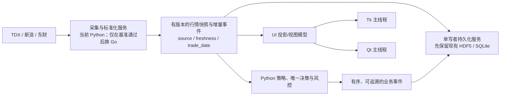

# 项目代码规模、性能现状与 Go 架构评估

日期：2026-10-11 14:04（Asia/Hong_Kong）  
范围：只读检查代码规模、已有性能记录和架构边界；不改生产代码、不运行测试或基准。

## 结论

- **可以用 Go 提升部分数据处理吞吐，但不建议一次性重写底层。** 只有实测确认瓶颈位于纯 Python CPU 计算、对象分配或进程间大对象传输时，Go 才是候选；Tk/Qt 原生绘制、网络等待和磁盘等待不会因改用 Go 自动变快。
- 当前更适合“Python UI 与策略保持，先收敛数据契约和拷贝，再把一个热点做成 Go 旁路服务”。必须按端到端延迟和数据一致性决定是否替换。
- 项目已有不少 Python 内部解耦和性能优化，不是单体程序整体未拆层；主要结构压力来自超大模块、多个实时消费者和快照/表格投影跨层。

## 代码量统计

统计口径：Git 已跟踪、当前工作区内容；物理行数含空行和注释；仅计 Python、JS、BAT、PowerShell 源码，不含 Markdown、Notebook、数据库、行情数据、二进制和构建缓存。未跟踪文件不计入。工作区已有暂存、未暂存和未跟踪修改，结果不代表干净提交的基线。

| 范围 | 文件数 | 物理行数 |
|---|---:|---:|
| 全部已跟踪源码 | 728 | 507,713 |
| Python | 696 | 503,071 |
| Python：排除 `tests/`、`scratch/`、`unit_test/`、`jupyterAlgo/` 和 `temp*` 文件 | 591 | 450,663 |

主要 Python 目录：仓库根目录 233,687 行（233 文件）、`ats/` 133,597 行（157 文件）、`JSONData/` 29,861 行、`tools/` 16,786 行、`instock_data_fix/` 14,255 行、`tests/` 10,353 行、`tk_gui_modules/` 9,976 行、`trading_kernel/` 7,532 行。统计说明当前维护面较宽；它不等同于有效业务代码行数或维护成本。

较大的活跃模块包括 `instock_MonitorTK.py` 25,771 行、`trade_visualizer_qt6.py` 17,991 行、`ats/ui/intraday_strategy_dialog.py` 13,578 行、`JSONData/tdx_data_Day.py` 9,489 行、`ats/ui/main_window.py` 8,475 行。仓库还含 `temp_old_ver.py` 等旧版本/临时脚本，扩大总数但不应作为活跃系统规模解读。

## 已有性能证据

以下是仓库中已保存的运行日志和基准，不是本轮重新测量；隔离基准与实盘完整工作负载不可直接等同。

| 链路 | 已记录结果 | 可得出的结论与限制 |
|---|---|---|
| TK 行情摘要/IPC | 一次实运行日志 `PumpLag=20.775s`，其中 `Hash=20.354s`。随后删除消费端四次全表扫描；本地 5,604 行×500 列合成数据中，旧扫描 316.057ms，版本键 0.146μs，摘要分配峰值 44.157→12.156MiB。 | 全表内容扫描和复制是数据链路热点候选。合成数据未复现 20.354s，修复后的真实运行延迟尚未回测。见 [TK 内存优化记录](../../docs/TK_MEMORY_OPTIMIZATION_20261009.md)。 |
| TK 表格重绘 | 45～75 列在 1200px 视口下裁剪后，5500 行重绘 P50 约 132～142ms，较前一版下降约 75%；2938px 宽视口仍约 328～330ms，因为屏幕内仍需画约 45 列。200 行与 5500 行结果接近。 | 主要成本是可见单元格的 Tk 原生同步绘制，不是 Python 全表行数。Go 后端无法消除这段 UI 线程绘制。数据来自映射离屏窗口，非显示器端到端实盘延迟。见 [TK 列视口基准](../../design/tk_column_viewport_20261009.md)。 |
| Qt 图表/股票表 | K 线 20,000 根，仅末根变化 `setData` 由 252.088ms 降至 3.470ms；可见 150 根的 paint 由 75.681ms 降至 0.967ms；5,000 行表格更新 5 行由 286.028ms 降至 2.437ms。 | 增量缓存和只更新脏行能带来数量级收益，且不需要换语言。基准是同一机器上的离屏合成负载；没有测完整行情窗口的长期 FPS。见 [可视化性能验收](../../docs/TRADE_VISUALIZER_PERFORMANCE_20261004.md)。 |
| TK 启动/内存/退出 | 历史日志记录行情获取 24.24s、400 条信号插入 11.85s；曾观测主进程约 1.0～1.9GiB RSS（不同时间点）。之后做了异步首帧、缓存和退出路径优化，但完整实盘复测待做。 | 应区分行情等待、后台计算和 GUI 绘制。旧观测不能当作当前性能值。见 [TK 内存优化记录](../../docs/TK_MEMORY_OPTIMIZATION_20261009.md)。 |
| ATS 历史数据对象 | 缓存分配采样中反序列化对象约 479.9MiB；2,400 条分钟记录紧凑化后递归对象内存由 2,090,054B 降至 332,407B（84.1%）。 | Python 内改数据表示、按需加载已取得明显局部收益。该比例不是整个 ATS 进程 RSS 或端到端延迟降幅。见 [ATS 内存优化验收](../../docs/ATS_MEMORY_OPTIMIZATION_20261009.md)。 |

## Python 与 Go 的适用边界

| 热点 | Go 的预期收益 | 判断 |
|---|---|---|
| 大量纯 Python 字节码循环、每 tick 重复派生对象 | 较高：适合并行化和紧凑结构，但要实测 Go GC、拷贝及 IPC 成本 | 先用 CPU profile 确认占比，再选一个独立内核做回放对照 |
| NumPy/Pandas 已向量化的数值计算 | 不确定，可能很小；数据转入 Go 的序列化和复制会抵消收益 | 先减重复转换、缓存与全表复制；比较端到端成本 |
| DataFrame/快照跨进程传输 | 单改语言收益低；两边都要编码/传输数据 | 先定义稀疏增量、版本号和紧凑 DTO；展示快照可合并为最新值 |
| Tk/Qt 表格、图表原生绘制 | 低或无 | 优化可见单元格、虚拟化、增量模型及 UI 线程工作 |
| TDX/HTTP 等网络等待、HDF5/SQLite 写入等待 | 低或无 | 先改善请求去重、调度排队和单写者 I/O；按模块逐步迁移 |

CPython 的 CPU 密集 Python 字节码线程受 GIL 限制，进程可绕过但队列会 pickle 对象并复制到另一进程；Go 作为独立服务也要支付编码和传输成本。Qt 的 QWidget 必须留在 GUI 主线程，所以把计算搬到 Go 不能把 QWidget 绘制移出主线程。[Python GIL 说明](https://docs.python.org/3/library/threading.html#gil-and-performance-considerations) · [Python 多进程队列说明](https://docs.python.org/3/library/multiprocessing.html#pipes-and-queues) · [Qt 线程与 QObject](https://doc.qt.io/qt-6/threads-qobject.html)

Go 自身也需 profiling 和内存预算。Go 官方文档明确把 GC 参数描述为 CPU 与内存的权衡，建议通过 CPU/heap profile 定位热点，而不是默认 Go 一定更省内存或更低延迟。[Go GC 指南](https://go.dev/doc/gc-guide) · [Go 性能诊断](https://go.dev/doc/diagnostics)

## 建议的目标结构

- 用进程内接口先收敛边界，再使用 Windows 本地 IPC 连接 Go 服务；消息带 schema 版本、序号、`trade_date`、`source` 与 freshness。传输协议不应每次发送整张 DataFrame。
- 展示快照可只保留最新版本并合并中间帧；报警、决策审计、委托/订单状态等业务事件必须保序、可确认、可恢复，不能套用 latest-only 丢弃策略。
- UI 只消费不可变投影，在 Tk `after` 或 Qt queued signal 回到对应 UI 线程。Go goroutine 不直接持有 Tk/Qt 对象。
- 初期保留既有 HDF5、SQLite 和策略公开接口，由唯一写者维护锁、恢复及持久化语义；本轮不建议先改数据库格式或实盘执行链。

## 分阶段演进

1. **建立端到端基线。** 固定历史行情回放，按单调时钟分段记录接收、解析、规范化、复制/IPC、计算、UI 排队、模型更新与绘制；采集 P50/P95/P99、每阶段 CPU、进程组 RSS/Private Bytes、复制字节数、队列深度、丢帧/重复率与 freshness。不要用函数微基准代替端到端结果。
2. **先收敛 Python 数据面。** 统一 `MarketSnapshot`、`MarketDelta`、`StrategyResult` 之类的不可变契约；记录发布版本，避免消费端重复全表 hash/copy；展示与关键业务事件分流。用相同回放验证输出逐条一致。
3. **做单热点 Go POC。** 候选优先是 profile 证实的纯 Python tick 归并/滚动统计/筛选循环，不是 UI 或数据库全量重写。Go 服务读取历史回放，在旁路模式输出结果，不改变现有唯一决策、风控和执行。
4. **双跑对账后切一条链路。** 逐标的、逐序号比较 Python 与 Go 的结果、时效和空值语义；测含 IPC 的端到端 P95、CPU、内存、打包/启动成本。只有端到端收益稳定、关键事件零丢失、可回退，才把该模块切到 Go。
5. **按热点扩展。** 若主要卡点仍是宽表 Tk 原生绘制，单独评估可视行/列模型或 Qt Model/View；这属于 UI 架构决策，Go 服务不能替代它。

## 本轮边界

本轮只统计源码并读取已存在的性能记录和架构文档；没有运行实时行情、交易链路、测试或新基准。最新实盘完整运行的分阶段耗时、所有进程 RSS/P95 及各主要纯 Python 函数的 CPU profile 仍缺，因此目前不能给出“改 Go 后全系统会快 X%”的可信数字。
