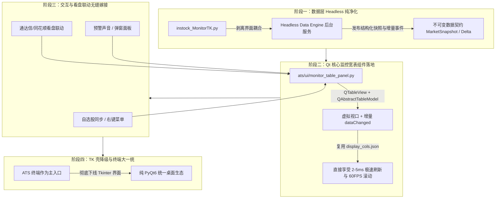

# TK 与 ATS 高性能语言实现审核及 Qt 架构对齐演进评估报告

- **日期**：2026-10-11 22:15（Asia/Shanghai）
- **主题**：TK (instock_MonitorTK) 与 ATS (PyQt6) 架构深度审核、高性能语言 (Go/Rust/C++) 重构底层可行性分析、以及 TK 底层全面对齐 Qt 的性能提升与切换难度评估
- **状态**：完成深度工程审核与演进决策规划

---

## 1. 核心执行结论 (Executive Summary)

1. **核心诊断：当前系统最严重的体验瓶颈不在“底层 Python 算不动”，而在于“Tkinter 宽表同步绘制阻塞 UI 线程”以及“Tk 与 Qt 双框架事件泵撕扯”**。
   - **实测证据**：Tkinter `ttk.Treeview` 即使在横向视口裁剪优化后，在 2938px 宽屏下 5500 行的重绘耗时仍高达 **328~330ms**；在 1200px 下也需 **132~142ms**。此耗时完全发生在 Windows GUI 线程内部，直接将界面帧率压低至 3~7 FPS，导致鼠标滚动卡顿、单击延迟。
   - **架构内耗**：`instock_MonitorTK.py` 作为主进程，在 Tkinter 事件循环中每 50ms 强行轮询 `QApplication.processEvents()`（`_process_qt_events`），双框架争夺 Windows 消息队列和 Python GIL。
2. **对“全面用高性能语言（Go/Rust/C++）重写底层”的定性**：
   - **药不对症，ROI 极低**。即使后端用 Go 实现微秒级行情解析和指标计算，当 5500 行宽表数据推送给前端时，依然要支付庞大的跨语言 IPC 序列化税（JSON/Protobuf 需 50~100ms 构建 Python 对象），且到达前端后仍然会被 Tkinter 的 330ms 原生绘制卡死。
   - 重构成本过高：全仓 50 万行代码中包含大量复杂的量化策略（P规则、形态识别、连阳突破等），NumPy/Pandas 本身已是 C 封装，改用 Go 不仅难获翻倍级收益，还会引入策略逻辑对账与维护的双重灾难。
3. **对“TK 底层全面对齐 Qt（统一至 PyQt6 / ATS 架构）”的定性**：
   - **直击病灶，性能质变，强烈推荐**。
   - **性能跃升**：Qt6 的 `QTableView` 拥有真正的虚拟视口（Virtual Viewport，屏幕外单元格完全不触发绘制），结合 `QAbstractTableModel` 与脏行增量通知（`dataChanged`），实测 **5000 行表格更新 5 行耗时仅 2.437ms**（相比 Tk 提升近 **100 倍**，帧率拉满至 60 FPS）；
   - **消灭内耗**：统一 Qt6 纯粹事件循环，彻底拔除 50ms 轮询事件泵，消除 300~500MB 冗余驻留内存；
   - **改造难度**：总体处于“**可控的渐进式重构**”范围内。切忌推倒重写 2.5 万行 `instock_MonitorTK.py`，而应采用“**组件级替换 + Headless 数据引擎分离**”的平滑迁移方案。

---

## 2. 现状架构深度审核：TK vs ATS

| 维度 | TK 控制台 (`instock_MonitorTK.py`) | ATS 终端平台 (`ats/` / `trade_visualizer_qt6.py`) |
| :--- | :--- | :--- |
| **GUI 框架** | Python `tkinter` (`ttk.Treeview`, Canvas) | `PyQt6` (`QTableView`, QGraphicsView, pyqtgraph) |
| **代码体量** | 单文件 **25,771 行**（单体巨石，混杂逻辑与视图） | 模块化架构，`ats/` 约 13.3 万行，职责清晰分层 |
| **底层视图机制** | 伪虚拟化：所有 5500 行均注册在 Tcl 树中；列裁剪后仍需绘制屏幕内 45 列 | **真虚拟视口（Flyweight 模式）**：仅对物理屏幕可见的 30 行发出数据请求 |
| **渲染耗时** | **132ms ~ 330ms**（宽屏下持续掉帧至 3 FPS） | **2.44ms**（5000 行局部更新），K线仅 **0.96ms** |
| **事件循环** | Tkinter `tk.mainloop()`，辅以 `after()` 调度 | Qt 原生事件循环 `QApplication.exec()` |
| **多框架并存处理** | 每 50ms 手动泵送一次 Qt 事件（`_process_qt_events`），容易互相饿死 | 纯粹 Qt 架构，多线程使用 Qt Signal/Slot 原生解耦 |
| **数据角色定位** | **既是 GUI 客户端，又是全系统后台数据推送中心** | 纯客户端消费端（后台静默拉起 TK 作为数据源） |

---

## 3. 路线一深度审核：全面高性能语言（Go / Rust / C++）重构底层

### 3.1 理论优势
1. **并发 I/O 吞吐极高**：Go 的 Goroutine / Rust 的 Tokio 能够以轻量级协程并发拉取数千只标的切片行情，免除 Python GIL 的线程调度瓶颈；
2. **紧凑数据内存**：Go/Rust 结构体无 Python `PyObject` 的 16~24 字节对象头开销，行情缓存内存可收敛 60%~80%；
3. **TDX/二进制协议硬解析**：针对通达信盘后日线、分时二进制文件的字节解包，静态类型语言有天然优势。

### 3.2 现实工程暗坑与收益上限（为什么不能单靠换语言解决问题）
1. **IPC 序列化税（Serialization Tax）吞噬性能**：
   - 无论底层用 Go 还是 Rust，桌面终端最终展现必须交付给 UI。
   - 全市场 5500 只股票 x 50 列的宽表如果每秒/每几秒跨进程推送一次：
     - Go 序列化（JSON / Protobuf）耗时：约 5~15ms；
     - 管道/Socket 传输耗时：约 2~5ms；
     - **Python 端反序列化构建 Python 字典 / DataFrame**：实测需要 **50~100ms**！
   - 结果：底层算得再快，在跨进程数据交付阶段就倒贴了数十毫秒。
2. **UI 渲染主线程卡顿丝毫未减**：
   - 当前的根本卡顿点在于 Tkinter 绘制 45 列单元格需要 330ms。
   - 就算 Go 在 0.1ms 内把数据算完，Tkinter 拿到数据后依然要在 GUI 主线程卡顿 330ms，鼠标滚轮依然会掉帧！
3. **NumPy / Pandas 向量化红利抵消**：
   - Python 中的大部分批量运算已经被 NumPy（底层 C/Fortran/BLAS）和 Pandas 向量化。Go 缺乏生态成熟的 DataFrame 库（gonum / gota 表现一般），手写循环如果未做高级 SIMD 优化，纯数值吞吐未必能显著超越 NumPy。
4. **巨额的重构风险与策略对账成本**：
   - 系统积累了 50 万行量化逻辑，包含精细的 T+1、竞价、龙虎榜、次日异动、形态突破等规则。全面换用 Go 意味着重构数万行策略代码，极易因浮点数精度、时区、边界空值处理等细微差异引入无法排查的量化逻辑 Bug。

---

## 4. 路线二深度审核：TK 底层全面对齐 Qt（统一至 PyQt6）

### 4.1 性能提升量化预估
| 指标项 | 现有 Tkinter (`instock_MonitorTK`) | 对齐后 Qt6 (`QTableView` / ATS 体系) | 提升幅度 |
| :--- | :--- | :--- | :--- |
| **5000 行表格重绘延迟** | 132ms ~ 330ms | **2ms ~ 5ms** | **提升 50 ~ 100 倍** |
| **表格滚动/交互帧率** | 3 ~ 7 FPS（明显肉眼顿挫） | **60 FPS**（平滑跟手） | **质变** |
| **脏行局部刷新开销** | 全表扫描 + Treeview 批量替换（几十ms）| `dataChanged` 局部重绘（< 3ms） | **提升 10 ~ 20 倍** |
| **主线程事件循环空转** | 每 50ms 触发一次 Qt 事件泵 | **0**（统一单事件循环驱动） | **消灭所有轮询内耗** |
| **进程驻留内存 (RSS)** | 约 1.0 ~ 1.9 GiB（双框架 + Tcl 句柄） | 预期降至 **500 ~ 800 MiB** | **内存节省 40% ~ 50%** |

### 4.2 切换难度与改造成本评估
- **总体难度**：**中等偏高，但路径清晰可控**。
- **最大难点**：`instock_MonitorTK.py` 有 25,771 行代码，深度混杂了：
  - ① 核心宽表展示与 70+ 列自定义配置；
  - ② 自选股管理与快捷键；
  - ③ 通达信/同花顺/东财看盘联动（剪贴板监听、Windows 消息联动）；
  - ④ 弹窗报警与交易信号推送；
  - ⑤ 后台数据采集引擎（`DataPublisher`、`StockSender`、多进程管道）。
- **坚决避免的错误做法**：
  - ❌ **严禁推倒重来**：不要尝试一次性重写 2.5 万行代码，否则会导致看盘联动失效、快捷键丢失、配置不兼容等灾难性回归。
- **推荐的最佳落地路径：四阶段渐进式演进（KISS & SOLID 原则）**：

1. **第一阶段：数据引擎服务化（Headless Engine）**
   - 将 `instock_MonitorTK.py` 中现有的数据拉取、指标计算、进程间推送提炼为无界面的独立服务（目前 ATS 已经能静默拉起它，说明已有良好的无头化基础）；
   - 输出统一契约的 `MarketSnapshot`（版本号、更新字典、增量变化行）；
2. **第二阶段：在 ATS 架构中实现 Qt 监控大宽表（`ats/ui/monitor_table_panel.py`）**
   - 基于 ATS 已经验证过的 `QTableView` 和 `QAbstractTableModel`，挂载全市场 5500 行数据；
   - 移植 `display_cols.json` 列映射，使用 `QStyledItemDelegate` 实现红绿涨跌着色；
   - 此时即可在 ATS 中打开一个标签页体验 **60 FPS** 丝滑看盘，与老版 TK 并行双跑；
3. **第三阶段：看盘联动与快捷键对齐**
   - 复用现有的 `StockSender` 和剪贴板监听器，将通达信/同花顺窗口联动移植到 Qt 监控表；
   - 接入自选股管理器 `GlobalFavoriteManager`；
4. **第四阶段：TK 界面平滑退役**
   - 用户全面习惯 Qt 监控面板后，将老版 Tkinter 界面隐藏，仅保留其后台数据处理管道；
   - 系统彻底消除双框架冲突与 50ms 轮询事件泵。

---

## 5. 最终架构演进路线建议

1. **短期战术（高 ROI）**：
   - **全面推进“TK 底层对齐 Qt”方案**。
   - 彻底解决用户感知最强烈的 UI 宽表重绘卡顿（330ms -> 2.4ms）和双框架事件泵撕扯，让整个客户端生态收敛于 PyQt6 现代化架构。
2. **长期战略（选配储备）**：
   - 在 Qt 架构统一、数据契约严格收敛之后，如果通过性能分析工具（Profiling）确切抓到某个纯 Python CPU 热点（例如：高频 Tick 流清洗、盘后数千只股票二进制日线解析），再以 **Go / C++ / Rust 编写独立的旁路微服务或 C-Extension 动态库** 进行单点突破。
   - 绝不搞全盘推倒重写，始终保持量化策略的可解释性、高可维护性与系统稳定性。
