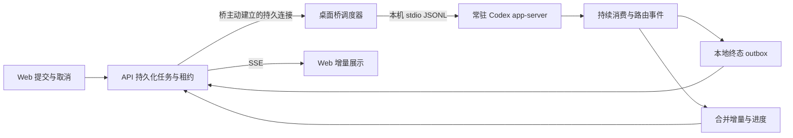

# 桌面 Codex 桥性能与超时审核

日期：2026-10-17，Asia/Hong_Kong。结论：需要修正可靠性问题后优化性能；保留桌面 Codex app-server 接入。

## 审核范围与证据边界

- 桥：`stock-strategy/desktop_strategy_agent.py`、`desktop_chat.py`、`desktop_runtime.py`、`desktop_engine_policy.py`、`desktop_sidebar.py`、`muse_research_threads.py`、桥启动器及管理器。
- Web/API：实际存在于被主仓 Git 忽略的 `stock-strategy/source/` 嵌套仓库；此前“本 checkout 没有 Web/API 源码”的判断需要修正。
- 重点检查 `easy-stock-analysis/backend/internal/httpapi/{codex_chat,codex_stock_research,auto_follow_ai,stock_research}.go`、`internal/stockanalysis/{research,research_levels,ai}.go` 和 `easy-stock-web/src/lib/use-stock-research.ts`。
- 审核开始时主仓 HEAD 为 `c23d088e`，嵌套源码 HEAD 为 `161bddc`，两者工作区无未提交改动。未核对正在运行的 EXE、生产 API/Web 与这两个版本是否一致。
- 用户截图：研究问题阶段 `context deadline exceeded`，总耗时 6 分 04 秒；桥在 2026-10-17 00:12:12 报 `chat_result` HTTP 409，任务短标识 `752cb671294e`。
- 未读取大日志/交易数据库，未发送真实模型任务、未重启程序、未触发交易。本文是源码审核和隔离验证，不是线上根因定责或性能基准。

## 当前故障的最强解释

1. 深度研究 `StageTimeout=6min`、`TotalTimeout=18min`，见 `research_levels.go:55`；阶段 context 在后端调用模型前创建，见 `stock_research.go:164`。
2. 阶段预算覆盖入队、排队、桥领取、进程启动、thread 准备和模型执行；桥却在 `turn/start` 完成后重新计时，见 `desktop_chat.py:161-165`。
3. 后端阶段 context 到期会把桥任务标记为 cancelled，见 `codex_stock_research.go:148-150,188-190`；随后 `Close()` 删除任务和会话，见 `196-203`。
4. 桥的下一次 running/终态回执因此可能遇到已取消或已删除的任务；入口统一返回 HTTP 409，见 `auto_follow_ai.go:46-49`。

这条路径与“约 6 分钟报研究问题超时，桥随后收到 409”高度一致。尚未关联该任务的完整时间线，不能确认模型真的生成了 6 分钟，也不能确定这次 409 的具体分支。

`Hermes研究问题失败` 也不能证明实际使用 Hermes：`stockanalysis/ai.go:714` 对所有 Prompter 都硬编码 Hermes 前缀，包括桌面 Codex。

## 必须优先修复

| 优先级 | 问题与位置 | 影响与处理 |
| --- | --- | --- |
| P1 | `desktop_strategy_agent.py:485` 的 `for queue in claim_order` 覆盖 queue 模块，`:560` 仍引用 `queue.Empty` | 该循环执行后，异常匹配可再抛 AttributeError，导致 agent 退出。仅重命名局部变量即可修复，保持接口。 |
| P1 | `desktop_chat.py:167-173` 在事件消费循环同步执行回执重试和心跳；`desktop_strategy_agent.py:204-226` 读取队列上限 128、入队等待 2 秒 | 网络阻塞期间停止消费，突发事件可能堵满队列并终止 reader。事件读取、HTTP 回执和心跳必须解耦，关键终态不能丢弃。 |
| P1 | 后端阶段超时包含排队，桥端执行超时从 turn 启动后开始；取消后立即删除任务 | 双方预算不一致，正常取消表现为异常 409；保留取消墓碑，桥确认 interrupt/终态后再按 TTL 清理。 |
| P1 | `auto_follow_ai.go:46-49` 把所有 desktopChatPeer 错误映射成 409 | 模型不匹配、任务不存在、租约失效、数据库错误混为一谈；返回稳定原因码，数据库暂时故障用可重试状态。 |
| P2 | `desktop_chat.py:119` 每任务启动，`:210` 每任务关闭 app-server；`ensure_project()` 每次重新扫描项目 | 深度研究各阶段重复冷启动和准备。常驻一个受监管进程，初始化一次，缓存项目 ID，错误时重新校验。 |
| P2 | `desktop_strategy_agent.py:592` 每轮都等待 5 秒，包括完成任务且队列仍有积压时 | 降低领取速度与吞吐；有工作立即继续领取，仅空闲时等待通知或退避。 |
| P2 | `sidebar.drain()` 在领取前和任务后同步执行；每次建立 AppTools 子进程并连续 RPC | 桌面侧边栏整理影响研究任务派发；改为独立低优先级工作，SQLite 连接由所属线程创建。 |
| P2 | 研究后端每 250ms 查询任务；Web 研究页每次响应后等待 1500ms 再查询 | 增加数据库和展示延迟；同进程通知唤醒等待者、Web 用 SSE，数据库保留为恢复依据。 |
| P2 | `chatDB()` 每次打开数据库句柄并执行建表；领取查询未见专用复合索引 | 随历史积累放大查询及锁竞争；迁移阶段建表、复用连接，先用查询计划验证索引收益。 |
| P2 | Web 研究同一 thread 的多阶段调用仍分别派发 job/启动进程；研究流程为 outline→core→trade，另有一次 repair | 不能把一次深度研究与 CLI 的一句问答比较；先消除各阶段固定成本，合并模型调用需要另做质量评估。 |
| P3 | `muse_research_threads.py:101` 每次扫描所有报告再取最近 100；非检测本地结果未见保留上限 | 长期 I/O 与磁盘增长；增量维护索引，已确认结果按策略保留，未确认 outbox 不清理。 |

重试预算需独立限制：按每次 HTTP 等待 8 秒计算，三次回执尝试加退避约 24.75 秒，之后还有心跳等待；目前这些等待发生在模型事件消费路径。单次 socket timeout 也不是整个业务操作的绝对截止时间。

不应把所有 409 改为重试，或接受任何迟到结果；已取消任务仍须保持取消，旧租约不能覆盖新租约。

## 推荐目标架构

- 本机保持 stdio；WebSocket 用于自有桥与后端的通知/取消/进度通道，不把 Codex 原始 RPC 暴露给浏览器。
- 持久连接负责唤醒，数据库原子 claim/租约代次负责所有权；连接消息丢失后仍能重新查询任务。初期可用统一长轮询替代自有 WebSocket，保留低频兜底扫描。
- 一个常驻 app-server 先保持单任务执行；按 thread/session 串行。测出排队需求后才增加有上限的独立 worker，避免跨租约、权限和 thread 串扰。
- 必须先实现 RPC ID→等待者、thread/turn→任务的事件分发，不能直接让多个任务并发调用现有 `request()/event()`。
- 心跳、增量、最终结果使用不同发送优先级；增量可合并覆盖，最终结果先持久化再发送，并等待幂等确认。
- 增量按 100–250ms 窗口或字节阈值批量发送，空内容不重复写；心跳频率按租约 TTL 留出重试余量，独立于是否生成 token。
- deadline 随任务下发；桥用剩余预算建立本机 monotonic 计时，并给回执/取消保留余量。明确排队预算、执行预算、端到端预算，不能在启动后重置完整预算。
- 取消携带 job、lease generation、thread、turn；桥执行 interrupt 并确认终态，后端保留墓碑防止迟到结果复活任务。
- app-server 退出后重启并恢复已保存 thread；无法确定是否完成的 turn 先对账，避免盲目重复生成。升级只在空闲边界切换并排空旧 worker。
- 保留冻结证据、source/trade_date/freshness、模型与 effort 校验和只读工具边界；线程缓存或研究结果缓存不得跨证据版本静默复用。

这套结构优化固定链路开销和可靠性，模型服务端推理仍决定主要生成耗时。不能承诺把深度研究压到几秒。

## 与 CLI 的可比差异

| 对比 | 当前桥 | 优化后桥 | 本机 CLI |
| --- | --- | --- | --- |
| 派发 | API 队列、轮询、固定等待 | 持久通知、原子 claim | 本机直接输入 |
| 引擎生命周期 | 每 job 新进程 | 常驻、空闲升级 | 交互会话可持续；一次性 exec 另计启动 |
| 输出 | 桥约 3 秒回传，Web 再轮询 | 增量合并、SSE | 本机流式输出 |
| 业务工作量 | 深度研究 3 个主阶段及可选修复 | 先保留同样研究流程 | 必须执行同样流程才可比较 |
| 额外能力 | 租约、恢复、节点选择、研究归档 | 保留并完善 | 业务层另行实现 |

当前默认 `--transport=local` 是桥启动独立桌面安装引擎进程，不等于直接复用正在显示的 Codex UI 进程。聊天调用没有传入 transport 参数，不能假定切到 desktop_proxy 就能统一所有链路。

OpenAI Docs 支持 app-server 持续会话、流式事件及 interrupt；官方把 app-server 的 TCP WebSocket transport 标为实验性。无需为本机通信追求 WebSocket 替代 stdio，也没有证据表明直接改成 codex exec 会提高同等模型/流程的生成速度。

官方资料：[App Server](https://learn.chatgpt.com/docs/app-server)、[Codex as a platform](https://developers.openai.com/blog/codex-as-a-platform)。本次未核对安装版本是否支持当前文档所有能力，实施前须以安装引擎协议为准。

## 实施顺序与验收

1. 修复 queue 覆盖、返回可区分错误码、统一 deadline、取消墓碑与幂等终态；先覆盖本次 6 分钟超时→取消→迟到回执路径。
2. 解耦事件消费和网络发送、持久 outbox；模拟慢网络、断网、重复回执、旧租约和突发 token，关键终态必须保留。
3. 常驻 app-server、缓存项目、忙时立即续领、侧边栏后台化；先单 worker 验证 thread/权限隔离、崩溃恢复和空闲升级。
4. 统一长轮询/持久唤醒、Web SSE、数据库连接复用与经测量确认的索引；随后才考虑有界多 worker。
5. 最后评估证据压缩、研究阶段合并或更低 effort；必须保持事实/时效/引用/研究完整性，不能默默降低用户选择的研究等级。

- 分别记录：入队→领取、领取→引擎准备、thread 准备→turn 启动、首 token、生成完成、本地持久化、后端确认、浏览器显示。
- API、桥、浏览器各用 monotonic 统计本地时长，跨机时间先校时；不能直接把不同机器 wall clock 差值当准确延迟。
- 冷/热启动、不同研究等级、短/长证据、空闲/积压、正常/弱网分别统计 P50/P95；每档至少 30 次有效样本，故障注入另计。
- 第一阶段可设目标：健康 LAN 热路径领取 P95 <500ms、桥收到增量→页面展示 P95 <500ms；这是待验证目标，不是现有性能或保证。
- 进度丢失可恢复、终态重复可确认、取消不复活、旧租约无覆盖；同时检查队列字节上限、内存趋势及进程回收。

## 实际验证

- `python -m pytest test_desktop_chat.py test_desktop_strategy_agent.py -q -p no:cacheprovider`：7 通过、1 失败。
- 失败为 `test_cancelled_lease_interrupts_native_turn_and_closes`：首次阶段回执就抛 OSError，app 尚未创建，所以其 closed/interrupt 断言失效；不能用此测试证明运行中取消链路已通过。
- `python -m pytest test_desktop_engine_policy.py test_desktop_sidebar.py -q -p no:cacheprovider`：15 通过。合计 22 通过、1 失败，未重复运行失败用例。
- AST 确认 main 的 queue 赋值，并在隔离 Python 片段复现异常处理二次抛出 `AttributeError: 'str' object has no attribute 'Empty'`。
- 内存 SQLite 验证 cancelled 后终态更新行数为 0、清理后记录不存在；这是状态条件验证，不是执行 Go API 集成测试。
- 当前命令环境未找到 Go，未运行 Go 测试、前端构建、真实模型基准或线上故障复现。未修改业务源码或部署产物，仅新增本报告。
