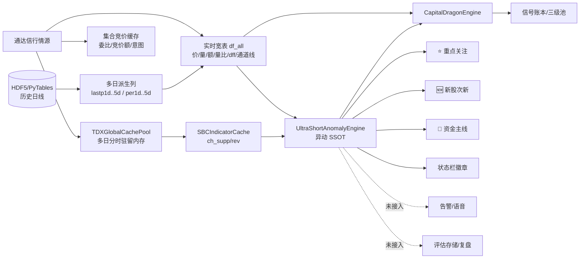

# ATS 异动捕捉全数据审计与优化方案

- **时间**：2026-10-20 19:05
- **范围**：`ats/ultra_short_anomaly_engine.py`（今日新增 SSOT）+ 其上下游数据版块、UI 消费方、退出引擎
- **方法**：源码逐行审计 + 调用链追踪 + 独立诊断脚本实测（不修改业务代码）
- **结论定位**：骨架正确、理念领先，但**信号质量层（可交易性/时间维度/校准）与闭环层（证据落库/结果回填）缺失**，导致"能算出来"但"不敢按它下单、也无法证明它准"

---

## 0. 一页结论

| 维度 | 现状 | 判断 |
|---|---|---|
| 数据广度 | 只用 `df_all` 快照 25 列 + SBC 分时缓存 | 系统内另有 **12 个数据版块** 未接入异动链路 |
| 结构识别 | 4 类底座（SBC连杀企稳/高开杀跌深V/冲高回落试盘/逆势抗跌）+ 1 类焦点池 | 逻辑合理，但**底座标签只增不减**，会陈旧 |
| 赛马捕获 | 每 1s 全市场扫描，状态机 5 态 | 无迟滞、无事件边沿、状态可回退 |
| 温度周期 | 单一宽度因子（上涨家数占比） | 与实战体感偏离，且**15m 斜率恒等于全时段变化**（实测） |
| 性能 | 实测 5500 只 **12.5~15.2ms** | 文档宣称 <2.5ms，实际 5~6 倍；日频特征每 tick 重算 |
| 可执行性 | 一字涨停被判"留强锁仓/冲板" | 无封板/停牌/流动性/时段守卫，产出**不可执行信号** |
| 闭环 | 仅 3 处 UI 展示 | 不进账本、不进告警、不落库、不回填 → **无法度量捕捉率** |

**最关键的三个判断**：

1. **候选截断机制与产品理念自相矛盾**。硬上限 120 只按"涨幅优先"截断，实测焦点池 400 只时，**涨幅 <0.6% 的冷盘种子存活 0 只**——而"冷盘选种"正是这套系统的立论基础。等于用"已经涨起来的"挤掉了"即将启动的"。
2. **温度周期是这套系统的心脏，但它的两个关键量是坏的**：`temp_slope_15m` 因 deque 容量不足（180 点 @1Hz = 180s）永远退化为"当前 − 开盘"；重启后 `min/max_temp` 被重置为当前值，`drop_from_max=0`，**退潮（COOLING_EBB）判定在重启后当天永久失效**。
3. **"去弱留强"的状态机不满足它自己的语义**：实测一只已加速到 +9.6% 的标的（👑 STRONG_LOCKED），正常回踩到 +3.8%（仍在 VWAP 上方）会被判为"⚠️ 过热未加速·出局 — 主力无拉升意愿"，回升后状态又退回"🌱 阶段特异蓄势"。**加速事实被抹掉，出局信号可反复触发**。

---

## 1. ATS 全数据版块地图

### 1.1 数据流总览



### 1.2 版块清单与异动链路使用情况

| # | 数据版块 | 权威载体 | 更新节拍 | 新鲜度标记 | 异动引擎使用 |
|---|---|---|---|---|---|
| 1 | 实时行情宽表 | `df_all`（`tdx_realtime_fetcher` 构建） | 1s（refresh gate 1.0s） | ❌ 无 | ✅ 直接消费 25 列 |
| 2 | 多日派生列（`lastp1d..4d`/`per1d..4d`/`lastv1d..4d`） | 宽表内联（`multi_period_cache`） | 日频 | ❌ | ✅ 结构识别主依据 |
| 3 | 多日分时缓存 | `TDXGlobalCachePool._history_static_bars / _incremental_intraday_pool / _daily_metrics_cache` | Tick 增量 | ⚠️ 有 date 字段 | ✅ SBC 结构还原 |
| 4 | SBC 指标缓存 | `SBCIndicatorCache`（`ch_up/mid/dn/supp/rev`） | 日频 | ❌ | ✅ 支撑/反转线 |
| 5 | 通道与反转线 | 宽表 `ch_pos/ch_supp_price/reversal_line` | 日频 | ❌ | ✅ 阶段低点判定 |
| 6 | 集合竞价（委比/竞价额/意图） | `auction_cache` + fetcher `order_intent` | 09:15–09:25 | ⚠️ 时段推断 | ❌ **未用** |
| 7 | 开盘阶梯跃迁 | `opening_bubble_engine` | 开盘 30min | ❌ | ⚠️ 仅 `tier_jumps` |
| 8 | 量能画像（首次放量时间/量能分） | `ats/volume_profiler.py` | Tick | ❌ | ❌ **未用** |
| 9 | 板块热度与资金强度 | `hot_sector_engine` / `sector_data_aggregator` / `sector_etf_engine` | 轮询 | ❌ | ❌ **未用**（`mainline_sectors` 是死参数） |
| 10 | 涨停/连板天梯 | `limit_up_engine` / `ladder_linkage_watcher` | Tick | ✅ 交易日归档 | ❌ **未用** |
| 11 | 新股次新/IPO | `new_stock_fetcher` / `ipo_*` | 日频 | ⚠️ | ⚠️ 仅展示注入 |
| 12 | 资金主线与龙头 | `capital_dragon_engine` | 1s（含异动重算） | ❌ | ⚠️ 反向消费异动 |
| 13 | 信号账本/三级池 | `signal_ledger` / `universe_manager` | Tick | ✅ revision | ❌ **未接入** |
| 14 | 次日异动候选池 | `next_day_anomaly_watch`（checkpoint + `bounded_evaluation_store`） | 4s | ✅ | ❌ **未复用** |
| 15 | 市场分布与温度 | `market_tasks.distribution_projection` / `dist_chart` | Tick | ❌ | ⚠️ 温度口径同源 |
| 16 | 持仓与主动退出 | `unified_paper_account` / `proactive_exit_engine` | Tick | ✅ | ⚠️ 仅过热一条规则 |
| 17 | IPC 双桥与联动证据 | `ipc_bridge` / `system_linkage_context` | 推送 | ✅ | ❌ |
| 18 | 复盘与可视化 | `trade_visualizer_qt6` / TradingAnalyzer | 盘后 | — | ❌ |

**一句话**：异动引擎是一座只用了 1/3 原料的工厂。**首次放量时间、委比承接、板块共振、涨停封板、连板高度**这五个最能区分"真异动/假异动"的信号，全部在系统里现成，但一个都没接。

---

## 2. 今日实现解构

### 2.1 处理链路

```
analyze_universe(df_all, focus_codes, mainline_sectors[死参], sh_pct, force)
├─ [0.8s 缓存闸] ────────────────────────────── 命中即返回，但检查在锁外
├─ 列提取 _col_f64 × 25 ────────────────────── 每 tick 全列 isnan 扫描
├─ 温度更新 MarketTemperatureCycleTracker ───── 单因子宽度
├─ 日频特征向量化 ──────────────────────────── down_days/multi_drop/stage_low/vol_ratio_1d
├─ 四类结构掩码 S/A/B/C + 焦点池 D ──────────── 全部基于"昨日+今日快照"
├─ 候选合并（含已跟踪）→ 硬截断 120 只（按涨幅）  ← 冷种子被挤出
├─ 逐行 Python 循环（持 _state_lock）
│   ├─ SBC 缓存解析（首帧每只 200+ bar Python 循环）
│   ├─ 结构标签赋值（只增不减）
│   ├─ 颈线/支撑/止损计算
│   ├─ 加速/冒头判定（瞬时快照，无 N 帧确认）
│   └─ 状态机 5 态判决（WEAK_BROKEN → OVERHEAT_EXIT → 加速 → 冒头 → 蓄势）
├─ 排序（状态权重 + 焦点 + SBC + 分数 + 涨幅×30）
└─ 返回 dict（≤120 × 60 键，每帧重建）
```

### 2.2 状态机与阈值的隐含假设

| 参数 | 值 | 隐含假设 | 风险 |
|---|---|---|---|
| `emerging_min_pct` | 1.6% | 所有板块同一波动尺度 | 20cm/30cm 板偏低，主板偏高 |
| `accel_main_board_pct` | 5.5% | 10cm 板 | 合理 |
| `accel_20cm_board_pct` | 7.5% | 20cm 板 | 北交所 30cm 被误归入 20cm |
| `overheat_stagnant_max_pct` | 4.2% | 绝对涨幅 | 20cm 板涨 4.2% 只是小涨，误杀 |
| `max_pullback_from_high_pct` | 2.8% | 全板块 | 20cm 板日内振幅常 >8%，噪声 |
| `temp_rise_cull_delta` | 10℃ | 温差 | 冷盘 36℃ 入场、涨到 46℃ 就该考核，但阈值要求 56℃ |

---

## 3. 实测证据（7 项，均可复现）

> 诊断脚本：`.tmp/_diag_ultra_short.py`、`_diag_ultra_short2.py`、`_diag_ultra_short3.py`
> 环境：`C:\Users\Johnson\anaconda3\python.exe`（pandas 1.4.4 / numpy 1.21）

| # | 验证项 | 实测结果 | 结论 |
|---|---|---|---|
| 1 | 5500 只扫描耗时 | `min=12.52ms / med=12.76ms / max=15.20ms`；缓存命中 `0.036ms` | 与文档"<2.5ms"差 **5~6 倍**；测试阈值 25ms 过松 |
| 2 | 温度斜率 | 180 点 @1Hz；`slope_5m=8.7`、`slope_15m=8.7`、日累计=9.7 | **15m 斜率 ≡ 全时段变化**，5m 斜率实际是 3 分钟 |
| 3 | 重启后温度锚点 | 重启后 `min=max=70.0`、`drop_from_max=0.0` | **退潮判定当天永久失效** |
| 4 | 跟踪池淘汰 | 首帧 107 只 → 全部破位后仍 107 只，全部 `WEAK_BROKEN_EXIT` | 无 TTL/无淘汰，**每秒 107 条出局噪声** |
| 5 | 候选截断 | 焦点 400 只 → 只跟踪 120 只；池内涨幅区间 `+2.07%~+3.00%`；**涨幅<0.6% 冷种子存活 0 只** | 截断策略与"冷盘选种"理念**直接冲突** |
| 6 | 加速后回撤 | `+9.6% STRONG_LOCKED` → 回踩 `+3.8%` 判为 `⚠️ 过热未加速·出局` → 回升 `+6.0%` 退回 `🌱 阶段特异蓄势` | **加速事实被抹掉，状态可回退，出局可反复** |
| 7 | 一字涨停可交易性 | `high==low==close=22.0`（封死）→ `👑 特异加速·留强` / `留强锁仓/冲板` | **产出无法买入的信号** |

---

## 4. 问题清单

### A. 正确性缺陷（会让信号"错"或"不可执行"）

| ID | 问题 | 证据 | 影响 |
|---|---|---|---|
| A1 | `temp_slope_15m` 恒等于全时段变化 | `deque(maxlen=180)` @1Hz = 180s；循环 `if age<=900: t_15m_ago=temp_h` 永远取不到 900s 前 | `COOLING_EBB` 依赖 `slope_5m < -1.5`，判定失真 |
| A2 | 重启丢温度锚点 | `reset_daily` 置 `min=100/max=0`，首帧 `open=min=max=curr` | 盘中重启后过热/退潮判定失效 |
| A3 | 候选硬截断按涨幅优先 | 见实测 #5 | 冷盘种子系统性丢失 |
| A4 | 跟踪池无 TTL/无容量预算 | 见实测 #4 | 预算被破位股占满 + 重复出局 |
| A5 | 加速后回撤语义错误、状态可回退 | 见实测 #6 | 真龙被误杀；`is_accelerated` 粘性但状态不粘性 |
| A6 | 无交易时段守卫 | `analyze_universe` 仅做日期翻转，无 session 判断 | 竞价/盘后写入 `entry_price/entry_temp` 锚点 |
| A7 | 无可交易性过滤 | `valid_stock_mask = close>0.5 & 非ST/指数` | 封板/停牌/低流动性/新股均产出"可跟"信号 |
| A8 | 温度单因子宽度 | `temp = up/total×100` | "60% 微涨 + 40% 大跌" = 过热 60℃，与体感相反 |

### B. 架构与性能

| ID | 问题 | 证据 |
|---|---|---|
| B1 | 日频静态特征每 tick 重算 | `multi_drop_pct / down_days_prev / 结构掩码` 均为日频常量，实测 12.5ms |
| B2 | `np.isin(object数组, list(set))` × 2 处 | 行 1100/1101，O(n×m) 且每 tick 把 set 转 list |
| B3 | `_get_sbc_cached_codes()` 每 tick 调 2 次 | 行 829（`_collect_focus_pool_codes` 内）+ 行 860 |
| B4 | 每帧重建 120×60 dict | `item.to_dict()` 在循环内，GC 压力 |
| B5 | `mainline_sectors` 死参数 | 行 836 签名，函数体零引用 → 板块共振完全缺失 |
| B6 | 双引擎同 tick 重复调用 | `LedgerWorker`（1Hz）+ `CapitalDragonEngine._analyze_capital_dragon_universe` 各自调 `analyze_universe`，0.8s 缓存在锁外检查 |
| B7 | `is_20cm_board` 北交所误判 | 行 381 把 `83/87/43/920` 归入 20cm（实为 30cm） |
| B8 | `"ratio"` 别名冲突 | `pcts` 与 `turnovers` 候选列都含 `"ratio"` → 若上游用 ratio 表示涨跌幅会串列 |
| B9 | 底座标签只增不减 | `down_days_count = max(...)`；`elif not item.structure_type` 才补，永不清除 |

### C. 捕捉有效性缺口（"更有效"的核心）

| ID | 缺口 | 后果 |
|---|---|---|
| C1 | 评分是手工 magic number，无历史校准 | 无法回答"这个信号历史上准不准" |
| C2 | 无事件边沿 | `emerging_codes` 每帧重复，下游若直连告警会风暴 |
| C3 | 无证据落库/结果回填 | 无法度量捕获率、误报率、MFE/MAE |
| C4 | 无时间维度（时段权重/尾盘折价） | 09:35 的 +1.6% 与 14:55 的 +1.6% 同权 |
| C5 | 无板块共振维度 | 同板块 3 只同时冒头 ≠ 孤狼脉冲，现无法区分 |
| C6 | 无多周期确认 | 只有日线派生 + 当日快照，缺 5m/15m 突破确认 |

---

## 5. 优化方案：四层重构

### L0 日频底座层（解决 B1/A3/A9，解锁回测）

**目标**：把"昨日及以前决定的一切"从每 tick 计算中彻底剥离。

- **产出**：`BaseTable`（每股一行，numpy 结构数组 + 按日 Parquet 快照）
  `code, down_days, multi_drop_pct, stage_low, neck, sbc_supp, sbc_rev, vol_ratio_1d, alpha_1d, structure_type, base_score, limit_pct, is_tradable, list_days`
- **构建时机**：09:10 前一次（盘前）+ 15:05 后一次（盘后归档）；盘中只读
- **收益**：
  - 单帧从 12.5ms → **<1.5ms**（L1 只剩 12 个标量比较）
  - 底座可**逐日回放**，直接支撑"历史同构胜率"统计（C1/C3）
- **兼容**：`analyze_universe` 签名不变，内部优先读底座，缺失时回退现有实时计算（灰度可切换）

### L1 秒级赛马层（解决 A5/C2/C4）

- **迟滞**：升级需连续 2 帧满足；降级需连续 3 帧不满足
- **事件边沿**：只在 `(code, from_state, to_state)` 迁移时产出 `events[]`；报告同时给 `snapshot[]`（全量现状）与 `events[]`（增量），下游各自取用
- **状态语义修正**（关键）：
  ```
  COLD_SEED_WATCH ──冒头──> HORSE_EMERGING ──加速──> STRONG_LOCKED
        │                        │                       │
        │                        │                       ├─回撤但守VWAP─> TRAILING（移动止损，不叫"未加速"）
        │                        │                       └─破VWAP/破颈线─> STOP_LOSS
        └────────破阶段低点───────┴──────────────────────> WEAK_BROKEN_EXIT
  STRONG_LOCKED / TRAILING 为不可逆态：不得回退到 COLD_SEED_WATCH
  ```
  新增 `RACE_STATE_TRAILING`、`RACE_STATE_SEALED_LIMIT`（封板不可跟）、`RACE_STATE_STOP_LOSS`
- **冷却期**：出局后 30min 内不重新入池（除"放量创新高"再入场）
- **时段权重**：`w(t) = 1.0 (09:30–10:00) / 0.85 (10:00–14:00) / 0.6 (14:30–15:00)`，作用于冒头分与阈值
- **板块归一化**：所有涨幅阈值改为 `ratio × limit_pct`（如 0.42×涨停幅），北交所按 30cm 单独取参

### L2 决策校准层（解决 C1/A8/C5/C6）

1. **温度多因子化**（保留原口径作 `breadth` 兼容 UI）
   ```
   T = 0.35·breadth + 0.25·strength(median_pct) + 0.20·limit_up(涨停家数/连板高度)
     + 0.10·turnover(成交额同比) − 0.10·break_rate(炸板率)
   各因子按近 60 日分位数归一，输出 0–100
   ```
   同时输出 `breadth / strength / sentiment` 三分量，让"60% 微涨+40% 大跌"显示为"宽度高、强度低"而非"过热"。
2. **时间桶采样**：温度历史每 30s 存一点，`deque(maxlen=120)` → 覆盖 60 分钟，修复 5m/15m 斜率
3. **锚点持久化**：`open/min/max/entry_temp` 落 `session_snapshot`，重启恢复（解决 A2）
4. **概率化评分**：以 `structure_type × 板块温度档 × 时段` 分组，用 60 交易日样本统计
   `P(MFE≥3%)`、`E[T+0 剩余收益]`、`n_samples`；样本 <30 时回退规则分。UI 直接显示"同构 n=143 · 胜率 62% · 平均 +1.8%"
5. **板块共振**：激活 `mainline_sectors`——同板块当日冒头数 ≥2 时 `resonance_bonus`，孤狼脉冲降权（与 `capital_dragon_engine` 的 `is_horse_emerging` 豁免逻辑对齐）

### L3 闭环层（解决 C3/A6/A7）

1. **证据落库**：状态迁移写 `bounded_evaluation_store.append()`（现成设施，`next_day_anomaly_watch` 已验证）
   字段：`code, ts, structure, temp, entry_price, from_state, to_state, reason, features_snapshot`
2. **结果回填**：T+0 收盘、T+1 开盘各回填一次 `MFE/MAE/收益`；自动汇总为胜率看板
3. **告警边沿化**：仅在 `events[]` 上调用 `alert_notifier.notify_special_signal(...)`（遵守"证据≠指令"边界：只提示，不派发交易）
4. **可交易性掩码**（解决 A7）：
   - 封板：`close ≥ 涨停价×0.998` 且 `vol_ratio` 骤降 → `SEALED_LIMIT`，文案改"封板不可跟"
   - 停牌：`vol==0` 或 `amount==0` → 剔除
   - 流动性：`amount < 3000万` → 降权/剔除
   - 新股：`list_days < 5` → 不走多日结构
   - 除权：`|per1d 推算涨跌幅 − 实际| > 3%` → 标记除权，跳过结构
5. **时段守卫**（解决 A6）：09:15–09:25 走独立"竞价异动"通道，不写 `entry_*`；非交易时段冻结状态机

---

## 6. 六个新增捕捉能力（增量 alpha）

| 能力 | 数据来源（现成） | 判定逻辑 | 预期收益 |
|---|---|---|---|
| **① 首放量时序** | `volume_profiler.first_surge_ts` | 09:30–10:00 首放量 + 站上 VWAP = 真点火；14:30 后首放量 = 对倒/诱多降权 | 剔除尾盘假异动，早盘信号权重↑ |
| **② 承接强度** | fetcher `bid_pressure`（委比） | 冒头帧委比 ≥70% 且未骤降 = 有承接；委比 <45% 冲高 = 虚拉 | 区分"抢筹"与"拉高出货" |
| **③ 板块共振** | `hot_sector_engine` + `mainline_sectors` | 同板块 2 只以上同时冒头 → 板块级异动，优先于孤狼 | 抓住板块启动第一波 |
| **④ 封板/连板上下文** | `limit_up_engine` | 冷种子直接封板 → 升 `STRONG`；连板高度≥3 → 情绪高潮，降低新开仓权重 | 避免高潮期追高 |
| **⑤ 多周期确认** | `multi_period_resampler` | 5m 收盘突破颈线 + 15m 结构不破 = 二次确认 | 降低单帧毛刺误报 |
| **⑥ 跨日跟踪** | `next_day_anomaly_watch` checkpoint | 昨日冷盘种子今日表现回填，形成"种子→兑现"链路 | 直接度量捕捉率 |

---

## 7. 分阶段落地路线

### 阶段一：正确性修复（P0，1~2 天，低风险）
1. 温度 deque 改 30s 桶 × 120 点；修 `slope_15m`
2. 温度锚点持久化到 `session_snapshot`
3. 候选截断改**分层配额**：冷种子 40% / 冒头 40% / 已跟踪 20%
4. 跟踪池加 TTL（20min 无更新且非焦点池 → 淘汰）+ 容量上限
5. 状态机加 `TRAILING/SEALED_LIMIT/STOP_LOSS`，`STRONG` 不可回退
6. 交易时段守卫 + 可交易性掩码
7. `structure_type / down_days_count` 每帧重算（允许清空）
8. 修 `is_20cm_board` 北交所、`"ratio"` 别名

**验证门槛**：现有 4 项单测全绿 + 新增 6 项（斜率/锚点/截断/淘汰/回撤语义/封板）全绿；5500 只扫描 ≤ 15ms

### 阶段二：架构分层（P1，3~5 天，中风险）
1. L0 日频底座表 + Parquet 快照 + 盘前构建
2. L1 只算动态量；`np.isin` 改哈希布尔掩码；SBC 池每 5s 缓存
3. 报告拆 `snapshot[] / events[]`；dict 改 ndarray + TopN
4. 激活 `mainline_sectors` 板块共振
5. 双引擎调用合并（CapitalDragon 复用 LedgerWorker 结果）

**验证门槛**：单帧 <1.5ms；底座与实时计算在 20 个交易日回放上结果一致率 ≥99%；UI 无回归

### 阶段三：校准与闭环（P2，1~2 周，需历史数据）
1. 温度多因子 + 三分量输出
2. 证据落库 + T+0/T+1 回填 + 胜率看板
3. 概率化评分（按结构×板块温度×时段分组）
4. 接入首放量/委比/连板/多周期四类新特征
5. 告警边沿化（语音可关，仅提示不派发）

**验证门槛**：60 交易日回放，各结构 `n≥30` 且胜率统计稳定；误报率（冒头后 30min 内跌破 VWAP）下降 ≥30%

---

## 8. 不变量与风险

- **不改变交易行为**：本轮全部为"分析/证据"层，不触碰 `signal_auto_dispatcher`、纸面账户执行、风控与 T+1 约束
- **证据≠指令**：异动信号只进"候选/证据"通道，人工确认后才可能进入三级池
- **向后兼容**：`analyze_universe` 签名、`report` 现有键（`candidates/emerging_codes/market_temp*`）全部保留，新增键不破坏 UI
- **性能回退保护**：L0 底座缺失时自动回退实时计算，不阻塞主循环
- **数据新鲜度**：建议给 `df_all` 增加 `trade_date` + `frame_ts` 属性，异动引擎显式校验（当前完全缺失，违反 AGENTS.md 的数据不变量）

---

## 附录：复现命令

```bash
cd D:/MacTools/WorkFile/WorkSpace/pyQuant3/stock_standalone
C:/Users/Johnson/anaconda3/python.exe .tmp/_diag_ultra_short.py
C:/Users/Johnson/anaconda3/python.exe .tmp/_diag_ultra_short2.py
C:/Users/Johnson/anaconda3/python.exe .tmp/_diag_ultra_short3.py
```

> 三个脚本仅构造合成宽表调用引擎，不写业务文件、不连行情源、不触碰实盘。
