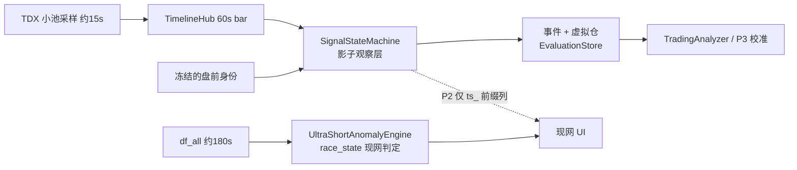

# 时序信号引擎：收益评估与 P1 优化落地方案（只出方案，不写代码）

- 文档时间：2026-10-21 20:45
- 评估对象：
  - `docs/tasks/2026-10-20_2045_ATS时序可交易信号引擎落地方案.md`（简称“原方案”）
  - `docs/tasks/2026-10-21_1235_时序信号引擎P0审核与后续任务评审.md`（简称“P0 审核”）
- 代码基线：分支 `feature/signal-timeline`，P0 `1aee36ed` + 修复 `a55a3b32`
- 本次实测：P0 相关 5 个测试文件 76 项全部通过（`pytest -q`）
- 范围：只读审核 + 方案，**没有改任何业务代码**

---

## 0. 结论

**值得继续做，但不能照原 P1 直接接入。** 必须先改三处前提，否则 P1 影子跑出来的对比数据没法用：

| # | 前提问题 | 严重度 | 不改的后果 |
|---|---|---|---|
| N1 | **数据节拍对不上**：原方案按 TDX 5~10s 推送切 15s bar 设计，但真正喂给引擎的是 `df_all`，个股价格大约 **180s** 才更新一次 | 致命 | 约 92% 的 bar 是空的或沿用旧值；`slope_3`、`structure(n=12)`、`ACCEL` 基本算不出有效值 |
| N2 | **盘前身份用的是盘中实时价**：`from_row` 读 `trade/close`，又按 `max(阻力, close×1.002)` 抬触发线 | 高 | 按 P0 审核的建议每 300s 重建一次身份，触发线会跟着价格往上走，**越涨越触发不了**；也违反了原方案的不变式 4 |
| N3 | **出现第三套状态模型**：两份文档都没提现有的 `SignalLifecycle` / `SignalLedger` / `SignalValidityTracker` | 高 | 和 AGENTS.md 要求的“唯一决策、职责分离”冲突，UI 和复盘会看到三套互相矛盾的状态 |

改完这三处以后，收益主要来自**可复盘的事件账本**和**状态防抖**，不是“更准的买点”。

---

## 1. 已实现部分核对

| 交付项 | 状态 | 核对结果 |
|---|---|---|
| `ats/signal_timeline.py`（BarClock / TrackSeries / TimelineHub） | ✅ | 幂等写入、午休跳过、gap 显式标记、`apply_bar_seconds` 切换时清空 |
| `ats/signal_state_machine.py`（状态机 / 事件 / 账本 / WeakStrongRanker） | ✅ | D1~D5 已修；纯计算，不做 IO、不开线程、不依赖 Qt |
| `ats/premarket_profile.py` | ⚠️ | 能用，但存在 N2 |
| CCT 13 个参数 | ⚠️ | 已能读写；`ats_signal_shadow_mode`、`ats_df_sync_interval` **代码里还没有地方读取** |
| 测试 76 项 | ✅ | 本次复跑全部通过 |
| P1 接入 | ❌ | 全仓搜不到 `signal_state_machine` 的调用方（`ipo_command_room_dialog` 里的 `_open_signal_timeline_*` 是同名的另一个功能），现在网上**没有任何行为变化** |

> P0 的投入已经花掉了（约 1900 行代码 + 76 项测试）。下面只按**后续投入的边际收益**来评估。

---

## 2. 新发现问题（含证据）

### N1【致命】数据节拍与 bar 粒度不匹配

证据链：
- `analyze_universe` 的两个实盘调用方 `ats/ui/main_window.py:307` 和 `ats/capital_dragon_engine.py:856` 传入的都是 `df_all`（TK 通过 IPC 推过来的宽表）。
- TK 侧 `instock_MonitorTK.py:11065`：`realtime_service.set_expected_interval(duration_sleep_time)`，而 `global.ini:9` 配置为 `duration_sleep_time = 180`。
- TDX 5s 轮询（`ats_tdx_interval`）实际只用在指数（`capital_dragon_engine._fetch_tdx_index_data`）和几个面板上，**不覆盖跟踪池里的个股**。

影响（以 15s bar 计）：
- 每 12 根 bar 才有 1 个新样本，`gap_ratio` 大约 0.92；
- `structure(n=12, k=2)` 只看 3 分钟窗口，最多 1 个有效点，HH/HL 判不出来；
- `max_hold_bars=80`（20 分钟）实际只有约 7 个样本，`TIME_STOP` 本质上是在看噪声；
- 原方案 §10.1 的性能数据没问题，但它测的是**算力**，没有检验**数据是否足够**。

### N2【高】身份层被盘中价格污染，触发线会“追涨”

- `premarket_profile.py:213` 中 `close` 取自 `trade/price/close`，盘中就是实时价；
- `:230` 是 `trigger_line = max(raw_trigger, close * 1.002)`；
- P0 审核第四节建议“每 300s 增量重建 `prior_score/trigger_line`”。两者叠加后，价格每抬高一次，触发线就跟着抬高 0.2%，`BREAK_TRIGGER` 很可能永远追不上；
- `_classify_structure` 也用了实时 `close`，结构身份会在盘中漂移。

### N3【高】与现有信号体系重叠，两份文档都没提

| 现有模块 | 已有能力 | 与新引擎的重叠 |
|---|---|---|
| `ats/signal_lifecycle.py` `SignalLifecycle` | DISCOVERED→…→ARMED→TRADE→WEAKENED→INVALIDATED，带合法迁移表和 `Transition` 历史 | 和 `SignalStateMachine` 的状态语义大部分重合，而且都有 `ARMED` |
| `ats/signal_ledger.py` `SignalEntry.sync_lifecycle` | 现网信号账本已经接入生命周期 | 新 `PositionLedger` 又是一套“持仓/信号”账 |
| `SignalValidityTracker.record_outcome` | T+1 高点/收盘结果回填 | 和 P3 的“回填 MFE/MAE”目标重叠 |
| `UltraShortAnomalyEngine.race_state` | 现网 UI 正在用 | 原方案的替代对象 |

如果不先明确定位，P2 上线后同一只票会同时出现 `race_state=留强`、`LifecycleState=WATCH`、`ts_state=HOLDING` 三种结论。

### N4【中】`max_positions=8` 会让校准样本有偏

账本满了以后，后来的触发不再开仓，P3 统计到的只会是“每天最早的 8 个触发”，系统性偏向早盘。校准阶段应该**每个触发都记一笔虚拟仓**，上限只用来排序展示。

### N5【中】时间参数按 bar 计数，会和 `bar_seconds` 绑死

`max_hold_bars`、`cooldown_bars`、`confirm_bars` 都是 bar 个数。只要调整 `bar_seconds`（N1 的修法必然要调），这些参数的实际含义就会悄悄改变。H1 的修复只解决了“缓存错位”，没有解决“参数含义漂移”。

### N6【低】参数已落 CCT 但没有消费点

`ats_df_sync_interval` 已经写进 `global.ini:70`，但原方案 §1.1 提到的 600s 硬编码还没有改成读取 CCT。应该在文档里写清楚，免得被当成已生效。

---

## 3. 收益评估

| 能力 | 用户收益 | 剩余成本 | 有没有更便宜的替代 | 判断 |
|---|---|---|---|---|
| 事件账本（迁移 + 原因码 + 证据） | **高**：现网 `race_state` 无法复盘，TradingAnalyzer 缺这类原料 | 低（P0 已有） | 没有 | ✅ 必做 |
| 进场后 MFE/MAE | **高**：直接修正“日内高点污染回撤”的问题 | 低 | 没有 | ✅ 必做 |
| 单调前进、确认 bar、最短驻留（防抖） | **中高**：解决“留强→出局→蓄势”来回跳 | 低 | 有：在现网引擎里用已有的粘性 `is_accelerated` 加确认计数，改动约 20 行 | ✅ 做，同时评估“现网速赢” |
| 15s 结构轴（HH/HL） | **当前数据下接近 0**（N1） | 中：要新建采样通路 | 改成 60s bar + 小池 TDX 采样 | ⚠️ 降级后再做 |
| 盘前身份 + gate | 中：可以替代“按涨幅截断” | 低（要修 N2） | 无 | ✅ 修完再用 |
| WeakStrongRanker 去弱换强 | 中：需要多持仓并存才有意义 | 低 | — | ⏸ P3 有数据后再启用 |
| P2 时间轴视图 | 低（收益慢） | 高（新绘图组件） | 事件流面板 | ❌ 暂缓 |
| P3 概率化校准 | 长期最高 | 中（需要 15+ 个交易日样本） | 复用 `EvaluationStore` | ✅ 但要分阶段 |

**总体判断：值得继续，ROI 中上。**前提是把 P1 定位成**影子观察层 + 复盘数据源**，暂时不承诺替代现网判定，并且在 P1 结束时设定能否继续的门槛（见第 6 节）。

---

## 4. 定位决策（P1 前必须确认）

建议的定位：
1. **新引擎只做观察和复盘，不参与决策**：不写 `SignalLedger`，不接 `SignalAutoDispatcher`，不触发语音告警，不碰执行链。
2. **账本统一叫“虚拟仓（paper）”**：文档和 UI 都不出现“持仓/开仓”字样，避免和真实持仓、T+1 混淆。
3. **和 `SignalLifecycle` 的关系**：P1 只在复盘报告里给出一张状态映射表，不改两边任何一方：DORMANT→DISCOVERED，ARMED→ARMED，TRIGGERED/HOLDING/TRAILING/ACCEL→TRADE，EXITING→WEAKENED，EXITED→INVALIDATED。是否合并放到 P3 用数据决定。
4. **替代 `race_state` 的决策推迟到 P3**，并且需要用户明确批准。

---

## 5. 优化后的落地方案

### P1-0 前置修正（必须先做，纯离线，不接入现网）

| # | 内容 | 做法 | 验收 |
|---|---|---|---|
| 0.1 | **冻结身份（修 N2）** | 每个交易日只在**第一次拿到数据时**建一次 profile。触发线和结构判定改用昨收（`lastp1d` 一类已有列），不用实时价。盘中刷新只更新 `prior_score` 等非价格字段；状态进入 ARMED 及以后，`trigger_line/defend_line` 当天不再变 | 新测试：盘中价格连续上涨并反复重建 profile，`trigger_line` 保持不变；跳空高开时依然能走 `GAP_BREAK_TRIGGER` |
| 0.2 | **时间参数改用秒（修 N5）** | CCT 新增或改为秒单位：`ats_signal_max_hold_sec=1200`、`ats_signal_cooldown_sec=480` 等，内部按 `bar_seconds` 换算成 bar；旧的 `*_bars` 参数保留读取作兼容回退 | 测试：`bar_seconds` 取 15 和 60 时，时间止损的实际秒数一致 |
| 0.3 | **默认 bar 改为 60s（修 N1）** | `ats_signal_bar_seconds` 默认改成 60。结构窗口 n=12 对应 12 分钟，`slope_3/12/48` 对应 3/12/48 分钟 | 测试：60s 配置下 240 bar/日、午休跳过、派生量数值正确 |
| 0.4 | **虚拟仓不设上限（修 N4）** | 每个触发都记虚拟仓；`max_positions` 只用来给超出部分打 `over_capacity` 标记和参与排序 | 测试：第 9 个触发仍然有事件和虚拟仓，并带 `over_capacity=True` |

预计：约 150~200 行改动，新增约 10 个测试。

### P1-1 独立采样通路（不依赖 `analyze_universe`）

- **数据源**：复用 `TdxRealtimeFetcher.get_security_quotes_safe`（自带限流退避），**不新建 TDX 连接**。
- **采样池**：所有处于 ARMED 或虚拟持仓状态的票 + `gate=PASS` 中 `prior_score` 前 N 名。N 由 CCT `ats_signal_pool_cap` 控制，默认 150；按 80 只一批算，每轮约 2 次请求。
- **节拍**：`max(ats_tdx_interval, 15s)`，保证每根 60s bar 至少有 2~4 个样本。
- **线程**：后台 daemon 线程，UI 线程不做任何 IO；结果放内存，`step` 天然幂等。
- **降级**：TDX 不可用时改用 `df_all`，bar 上标记 `source=dfall`，样本不足的 bar 照实记 gap，**不能把旧价当新价**。
- **解耦**：不挂在 `analyze_universe` 尾部，避开 3 个调用方重复调用和 120 只截断（P0 审核 H2）。

验收：交易时段 `gap_ratio(n=12)` 中位数 < 0.2，`n_samples` 中位数 ≥ 2；UI 主线程帧耗时无明显变化。

### P1-2 影子运行与对比口径

只写内存报告 + 迁移日志（**只记迁移事件，不每帧打日志**），连续跑 **5 个交易日**，每日收盘自动生成一份对比：

| 指标 | 定义 | 进入 P2 的门槛 |
|---|---|---|
| 数据质量 | `gap_ratio` 中位数、`n_samples` 中位数、`source` 分布 | gap < 0.2 |
| 状态翻转率 | 每只票每天的状态级别回退次数：旧 `race_state` 对比新 `ts_state` | 新版比旧版下降 ≥ 50% |
| 信号重合 | 新版多出 / 漏掉 / 共同的“进场”信号数 | 漏掉的旧信号都能用原因码解释 |
| 事后质量 | 进场后 30 分钟 MFE/MAE 中位数：旧 `STRONG_LOCKED` 进入点对比新 `TRIGGERED` | 新版 MFE ≥ 旧版，MAE 不更差 |
| 运行成本 | 采样线程耗时、TDX 限流触发次数 | 限流 < 5 次/日 |

### P1-3 持久化（复用现有设施）

- 事件和 60s bar 序列都通过 `EvaluationStore.append` 落盘，路径按交易日分区；**不新建 Parquet 写入逻辑**，避免出现第二套单写者和文件锁语义。
- 数据量：150 只 × 240 bar ≈ 3.6 万行/日，可以接受。
- 附带一个离线回放脚本：读取 bar 序列后重新跑状态机，用来做参数敏感性分析。

### P2 消费（P1 门槛通过后）

1. 先做**事件流面板**（`events()` 数据已经齐了），支持按原因码过滤；
2. 重点面板增加 `ts_state / ts_hold_min / ts_mfe / ts_mae / ts_exit_reason` 几列，**统一 `ts_` 前缀，不覆盖已有键**；
3. 时间轴视图暂缓。

### P3 校准（累计 15 个交易日以上）

- 先只做“原因码 × 结构类型”二维分组（约 20 组），结果输出给 TradingAnalyzer；
- 和 `SignalValidityTracker` 的 T+1 回填合用同一份结果表，**不做第二套回填**；
- 基于数据决定：`race_state` 是否改用时序版（需用户批准），以及 `SignalLifecycle` 是否合并。

---

## 6. 继续 / 止损门槛

| 节点 | 继续条件 | 不满足时的处理 |
|---|---|---|
| P1-1 完成 | TDX 小池采样能稳定在 gap < 0.2 | 退回到 180s 粒度：放弃结构轴，只保留**事件账本 + 防抖**，直接给现网 `race_state` 加事件记录 |
| P1-2 第 5 天 | 翻转率下降 ≥ 50%，事后 MFE 不差于旧版 | 停在 P1，影子数据只作复盘用，不进 P2 |
| P3 第 15 天 | 分组样本量足够，结论稳定 | 不替换现网判定 |

---

## 7. 可选：现网速赢（独立于新引擎，需要单独批准）

下面两项改的是**现网 UI 行为**，按 AGENTS.md 要求，须经批准才能动：
1. 温度环改为按时间戳计算 `slope_15m`，不再按 `deque(maxlen=180)` 的调用次数（`ultra_short_anomaly_engine.py:194`）；
2. `race_state` 判定改用粘性的 `item.is_accelerated`，并加 2 次确认（`:1326~1444`）。

两项合计约 30~40 行，能马上缓解原方案 §2.1/§2.2 描述的现象，而且和新引擎不冲突。

---

## 8. 明确不做

- 不新增第三方库，不新建 Parquet 存储，不新建 TDX 连接；
- 不接执行链、不写 `SignalLedger`、不触发语音告警；
- 不在 P1 改动任何现有函数签名或 UI 字段；
- 不做 P2 时间轴视图，不启用 WeakStrongRanker 自动换仓建议。

---

## 9. 待用户确认

1. **数据通路**：是否同意 P1-1 用 TDX 小池采样（默认 150 只、15s 一次）+ 60s bar？另一种做法是只用 `df_all` 的 180s 粒度，但那样基本等于放弃结构轴。
2. **定位**：是否同意新引擎在 P3 之前只做“影子观察 + 复盘”，不替代 `race_state`？
3. **现网速赢**（第 7 节）：是否单独批准？
