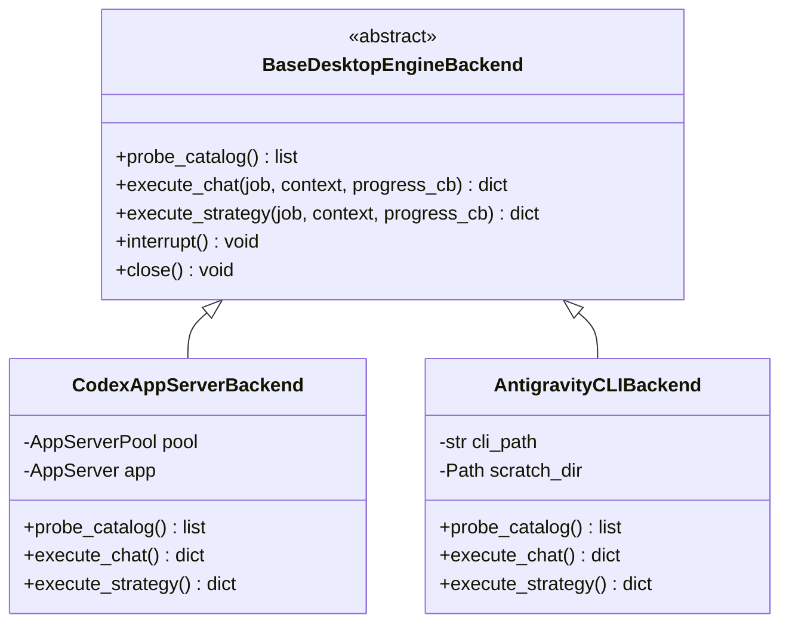
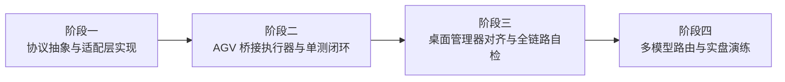

# Codex 桌面桥联动深度分析、Antigravity CLI (agv) 桥全功能对齐评估与接入落地实施方案

## 0. 任务元数据
- **日期时间**：2026-10-18 14:30
- **模块范围**：`stock-strategy/`, `webTools/window_manager/`, `ats/llm/`
- **核心目标**：全面分析 Codex 桌面桥联动设计及实现，评估 Antigravity CLI 模式的 agv 桥全功能对齐可行性，制定 agv cli 模式接入与推理模型选型实施落地方案。
- **工程约束**：严格遵守 KISS/YAGNI/SOLID/DRY，保持既有接口契约 100% 兼容，不中断主流程，确保 Windows / multiprocessing / SQLite 文件锁安全，UTF-8（无 BOM）保存。

---

## 1. 现有 Codex 桌面桥联动设计与实现全景剖析

### 1.1 系统定位与业务闭环拓扑
桌面桥（Desktop AI Strategy Bridge）是连接 **远程 Web 服务（easy-stock / Go API 后端）** 与 **本地量化交易终端（ATS / MonitorTK / RAMDisk 实时行情）** 的高可用 AI 协作者中枢。它解决了远程量化 Web 平台无法直接访问本地千万级高频盘口、分时图谱及敏感硬件环境的问题，同时保护实盘交易边界不受未授权网络指令侵入。

```mermaid
flowchart TD
    subgraph WebServer ["远程 Web / 策略调度中心 (easy-stock)"]
        WebQueue["任务调度队列 (Unified Queue / Lease)"]
        WebChat["AI 对话与投研看板"]
    end

    subgraph DesktopBridgeManager ["本地桌面管理器 (Qt / window_manager)"]
        UI["CodexBridgeManager 面板<br/>(桥名录 / 心跳监控 / 全链路检测 / 任务历史)"]
        LockMutex["Windows 命名互斥体<br/>Local\\PyQuant3CodexBridge_..."]
    end

    subgraph DesktopAgent ["桌面桥后台 Worker (run_desktop_strategy_bridge.py)"]
        Peer["DesktopPeer<br/>(HMAC-SHA256 签名双向认证 Pull 循环)"]
        Inbox["EventInbox (4MB/4096 事件聚合缓冲区)"]
        Pool["AppServerPool (串行单实例进程管理)"]
        Publisher["ProgressPublisher (异步流式进度发布器)"]
        Outbox["ResultOutbox (SQLite WAL 离线幂等出件箱)"]
        Ledger[("agent.db (SQLite WAL 账本)") ]
    end

    subgraph AIAppServer ["Codex 引擎进程 (AppServer)"]
        CodexCLI["codex.exe app-server --listen stdio://"]
        JSONRPC["JSON-RPC 2.0 (Thread / Turn / ToolCall)"]
    end

    subgraph LocalRuntime ["本地交易与行情环境"]
        RAMDisk["RAMDisk 虚拟内存盘"]
        ATS["ATS Terminal (Port 26670)"]
        TK["MonitorTK (Port 26676)"]
        IPCStore[("system_linkage.sqlite3 / trading_signals.db")]
    end

    WebQueue <==>|"HMAC-SHA256 Pull/Post (/api/v1/linkage/strategy/...)"| Peer
    Peer --> Pool
    Pool <-->|"stdio JSON-RPC (thread/start, turn/start, item/delta)"| CodexCLI
    CodexCLI -->|"item/tool/call (get_market_context)"| DesktopAgent
    DesktopAgent <-->|"只读安全提取"| IPCStore
    DesktopAgent <-->|"健康检查"| ATS
    DesktopAgent <-->|"健康检查"| TK
    DesktopAgent --> Outbox
    Outbox -->|"离线暂存 / 有界重试"| Ledger
    Publisher -->|"200ms 防抖流式回写"| Peer
    UI <-->|"读取 status.json / agent-status.json"| Ledger
```

### 1.2 核心组件与通信时序剖析

#### A. 任务拉取与双向认证 (`DesktopPeer`)
- **双向安全契约**：采用 `HMAC-SHA256` 签名机制，报文头包含 `X-Linkage-Node-ID`、`X-Linkage-Workspace-ID`、`X-Linkage-Timestamp`、`X-Linkage-Nonce`、`X-Linkage-Signature`，防范重放攻击。
- **轮询架构**：通过 `next`（统一任务队列，支持 chat 与 strategy 自适应加权）与 `chat_claim` 主动拉取任务，避免公网端口暴露。

#### B. 进程间传输与缓冲机制 (`EventInbox` & `AppServerPool`)
- **`EventInbox`（事件削峰聚合）**：
  - 设定了最大 4096 条事件或 4MB 的严格内存预算，超出则抛出 `BufferError`，彻底杜绝主内存泄漏。
  - **文本增量合并（Delta Coalescing）**：对连续到达的 `item/agentMessage/delta` 事件自动将文本片段追加合并，大幅减轻跨线程 Queue 唤醒与序列化负担。
- **`AppServerPool`（串行单实例池化）**：
  - 维护单一受控的 `AppServer` 子进程。
  - 在任务轮次空闲边界（Idle Boundary）通过指纹哈希（文件大小 + 修改时间戳）安全热更新或自愈，严禁打断正在运行中的会话。

#### C. 会话生命周期与只读工具注入 (`desktop_chat.py` & `desktop_strategy_agent.py`)
- **JSON-RPC 2.0 会话协议**：
  - 会话初始化：`initialize` -> `initialized`。
  - 线程管理：`thread/start`（新会话带入模型、配置、系统指示与动态工具）、`thread/resume`（带入已有 `threadId`，支持断点续聊，遇到过期异常自动平滑降级创建新线程）、`thread/name/set`（会话命名）、`thread/archive`（全链路检测结束后自动归档清理）。
  - 回合执行：`turn/start`（带入用户 Prompt、Schema、模型与推理强度）-> 监听 `item/agentMessage/delta`、`thread/tokenUsage/updated`、`turn/completed`。
- **只读风控证据工具（Dynamic Tools）**：
  - 向 Codex 动态注入 `get_market_context`、`get_stock_evidence`、`get_ats_evidence`。
  - 当 Codex 触发 `item/tool/call` 时，桌面桥在本地安全沙箱中读取 `system_linkage.sqlite3`、`trading_signals.db` 或局域网快照，并返回严格过滤的数据，严禁 shell 执行、写文件及下单权限。

#### D. 容灾、断网重发与幂等回写 (`ProgressPublisher` & `ResultOutbox`)
- **`ProgressPublisher`（流式进度解耦）**：
  - 独立守护线程，200ms 防抖聚合；网络出现 408/429/5xx 瞬时异常时不阻断正在运行的模型推理，保持心跳（20s 自动续期）。
- **`ResultOutbox`（持久化出件箱）**：
  - 基于 SQLite WAL 模式原子写入。任务终态结果首先写入 `result_outbox` 表并标记为待交付；即便在结果回写远程 Web 发生断网崩溃，重试机制在网络恢复后自动重放回写，回写成功后原子更新 `delivered_at`，杜绝重复扣费与结果丢失。

#### E. 桌面桥管理器与生命周期控制 (`codex_bridge_manager.py`)
- **单实例与进程归属校验**：
  - 结合 Windows 命名互斥体 `Local\PyQuant3CodexBridge_...` 与 `_bridge_owner_is_alive`，通过校验进程启动时间与命令行特征，杜绝 Windows PID 复用导致的误判。
- **全链路健康诊断**：
  - 提供一键“全链路检测”：下发专用任务（`CODEX_BRIDGE_OK`），端到端验证入队、桥领取、模型回复、结果回写与临时 Session 归档清理全流程。

---

## 2. Antigravity CLI 模式 (agv 桥) 全功能对齐可行性评估

### 2.1 Codex 桥 vs. Antigravity (AGV) 桥架构对比矩阵

| 架构维度 | 现有 Codex 桌面桥实现 | Antigravity CLI (agv) 模式 | 对齐评估与技术挑战 |
| :--- | :--- | :--- | :--- |
| **底层运行载体** | `codex app-server --listen stdio://` (长生命周期 JSON-RPC 2.0 服务端) | `agy` CLI 子进程管道 (`stream-json` 模式) 或 Python SDK (`google-antigravity`) | **可完全对齐**。AGV 提供了面向终端与脚本的 `stream-json` 交互流，以及底层的 SDK 接口。 |
| **会话/多轮管理** | 原生 `threadId` 状态机 (`thread/start`, `thread/resume`, `thread/archive`) | AGY CLI 默认以会话/Prompt 为单元；多轮通过消息列表历史注入或 Conversation ID 维系 | **轻量适配**。在 AGV 桥中，可将多轮历史以上下文 Messages 数组注入，或复用 AGY 本地会话机制。 |
| **动态工具回调** | 双向 RPC 反向调用：`item/tool/call` -> 本地执行 -> 回写 `inputText` | AGY CLI 支持 MCP 工具协议、预置只读上下文注入，或通过 SDK `ToolCall` 事件驱动 | **平滑对齐**。可采用“静态证据前置打包注入 + 动态 MCP 只读工具服务”双轨方案。 |
| **流式增量推送** | `item/agentMessage/delta` 实时推送，`EventInbox` 聚合，`ProgressPublisher` 广播 | AGY `stream-json` 逐行输出事件流（token streaming），SDK 提供 `response` 异步生成器 | **无缝对齐**。事件解析器适配 AGY 的 JSON 格式即可。 |
| **Token 与耗时统计**| `thread/tokenUsage/updated` 汇报 Input/Output/Cached Tokens | AGY 终态事件与元数据中包含 Token 消耗与 Duration 统计 | **完全对齐**。统一归一化为 `token_usage` 标准字典。 |
| **任务打断与取消** | RPC 请求 `turn/interrupt`，优雅中断当前推理 | 发送 Ctrl+C (SIGINT)、终止特定子进程树或 SDK 任务 Cancel | **完全对齐**。复用系统已有的 `_terminate_process_tree`。 |
| **安全沙箱与隔离** | `approvalPolicy: never`, `sandbox: read-only`, 禁用外部工具与网络 | `--sandbox`, `--disable-slash-commands`, Gate 0~5 校验, 只读目录隔离 | **安全等级更高**。AGV 天然具备完善的沙箱与敏感指令拦截机制。 |

### 2.2 核心对齐难点深度穿透

#### 难点 1：长连接 JSON-RPC vs. 进程管道事件流
- **现状**：Codex 使用长连接 `AppServer`，子进程持续存活，通过 stdin/stdout 的 JSON-RPC 请求 ID 进行 RPC 交互。
- **AGV 对齐设计**：
  - AGV CLI（如 `ats/llm/antigravity_cli_backend.py` 所示）采用 `--input-format stream-json --output-format stream-json`。每次会话启动轻量隔离子进程，或者利用常驻包装器维护进程生命周期。
  - 由于 AGY CLI 启动极快（百毫秒级），对于量化策略任务，每个 Task 独立运行在专用的沙箱目录（Scratch Directory）中，反而在多任务隔离和内存回收上比长连接更加干净、不会产生内存碎片。

#### 难点 2：量化数据动态工具调用（`get_market_context`）
- **现状**：Codex 在回答过程中自主决定是否调用 `get_market_context` 获取当前切片。
- **AGV 对齐设计（推荐最佳实践）**：
  - **方案 A（上下文预冻结注入，推荐）**：在桌面桥领取任务后、调用 AGV 前，预先在本地 0.1ms 内读取 `system_linkage.sqlite3` 获取当前市场快照，作为 `frozen_evidence` 随 Prompt 一同注入。这完全符合量化交易中“证据冻结（Deterministic Snapshot）”的确定性原则，避免模型因网络波动读到跨毫秒的脏数据。
  - **方案 B（本地 MCP Provider 注入）**：为 AGV 挂载只读本地 MCP 进程（`mcp-quant-provider`），暴露 `get_market_context`，AGV CLI 启动时指定该 MCP，实现与 Codex 100% 行为同构。

---

## 3. 使用 agv cli 模式实现接入的工程实施方案

### 3.1 架构设计：依赖倒置与双引擎抽象

遵循 **SOLID 原则（单一职责、开闭原则、依赖倒置）**，保持现有的 `run_desktop_strategy_bridge.py`、`ResultOutbox`、`ProgressPublisher`、`DesktopPeer` 契约不变，引入统一引擎抽象：



### 3.2 关键代码落地设计

#### 1) CLI 路径发现与检测对齐 (`desktop_runtime.py`)
在 `desktop_runtime.py` 中扩充对 AGV CLI 的探测：
```python
def antigravity_cli() -> str:
    """Resolve the Antigravity (AGY) CLI executable path."""
    configured = os.environ.get("ANTIGRAVITY_CLI_PATH", "").strip()
    if configured and Path(configured).is_file():
        return str(Path(configured).resolve())
    from ats.llm.cli_paths import resolve_cli_path
    return resolve_cli_path("", "agy")
```

#### 2) AGV 桥接执行器 (`desktop_antigravity_agent.py`)
利用 `agy --input-format stream-json --output-format stream-json` 实现与 `ProgressPublisher` 的流式桥接：
- 接收到任务后，在 `scratch/` 目录中生成专用的 `context.json` 与 `response.schema.json`；
- 启动 `agy` 进程，重定向 stdin/stdout；
- 独立线程读取 stdout 中的 JSON 事件行：
  - 遇到 `event: "message_delta"` 时，追加内容并通过 `publisher.publish(...)` 发送 200ms 防抖流式回写；
  - 遇到 `event: "result"` 时，提取最终结构化输出，执行 Schema 校验；
- 校验通过后，存入 `agent.db` 的 `chat_results` 表，并通过 `ResultOutbox` 幂等上报远程 Web。

#### 3) 配置切换与多引擎支持 (`global.ini` & `bridge.ini`)
在配置文件中提供引擎切换开关：
```ini
[general]
; 策略桥提供方支持: codex 或 antigravity
desktop_ai_provider = antigravity
antigravity_model = gemini-3.8-flash
```

#### 4) 管理器界面（`codex_bridge_manager.py`）平滑升级
- 管理器检测到 `desktop_ai_provider = antigravity` 时，界面桥目标显示为 `Antigravity (AGV)`；
- 状态探测、自启动、任务历史查看、全链路检测（发送测试 Prompt，预期返回 `ANTIGRAVITY_BRIDGE_OK`）全面兼容，无需推翻现有 UI。

---

## 4. 推理模型选择实施落地方案

### 4.1 量化监控与策略研判的特征诉求
1. **超低首字延迟（TTFT）与高吞吐**：盘中异动秒级甚至亚秒级响应，杜绝阻塞主线程；
2. **零幻觉与强数值一致性**：价格、涨跌幅、均线、时间戳必须精确匹配证据，严禁编造；
3. **严格结构化输出（JSON Schema 依从率 100%）**：下游策略决策依赖强类型解析，任何格式错误都会触发 Fail-Closed；
4. **合理的配额与成本结构**：支持高频心跳探测与多周期持续监控。

### 4.2 模型梯队选型与任务路由矩阵

| 任务场景 | 推荐模型 | 核心优势与选型依据 | 降级与备选方案 |
| :--- | :--- | :--- | :--- |
| **1. 全链路连通性自检 (`bridge_test`)** | **Gemini 3.8 Flash** | 响应耗时 < 300ms，极速验证桥接连通性，消耗极低。 | Gemini 2.5 Flash |
| **2. 盘中高频对话与个股异动速查 (`ai_chat_v1`)** | **Gemini 3.8 Flash** | 首字延迟极低，流式打字丝滑无卡顿，上下文理解迅速。 | Gemini 2.5 Flash / Flash-Lite |
| **3. 策略逐股条件提案 (`stock_research_v1`)** | **Gemini 3.8 Flash (High Reasoning)** | 具备受控的轻量思考链，能严格依照传入的行情数据完成 JSON Schema 输出。 | Gemini 3.8 Pro |
| **4. 盘后深度复盘与长周期归因 (`TradingAnalyzer`)** | **Gemini 3.8 Pro** | 具备数百万 Token 的超长上下文能力，可一次性容纳全日 Tick、分时、交易流水及全市场板块轮动数据，推演深层因果关系。 | Gemini 2.5 Pro |
| **5. IPO 新股离线观察 (`--ipo-learning` Gate 4/5)** | **Gemini 3.8 Pro** | 复杂的模式识别（D1-D3 标签推演、负样本 near_miss 分析），逻辑缜密。 | 本地 Ollama (Qwen2.5-Coder-7B) |
| **6. 外网离线 / 断网风控应急** | **本地 Ollama / LiteRT** | 本地离线运行，绝对内网隔离，保证基本问答不瘫痪。 | 本地规则兜底 |

### 4.3 动态推理强度（Reasoning Effort）策略
- **`low`（低思考 / 直出）**：用于连通性检测、简单指标查询、标题生成；
- **`medium`（标准思考）**：用于个股走势分析、盘中条件判断、风险提示；
- **`high`（深度推演）**：用于复杂选股逻辑、反转形态确认、多周期矛盾信号排查。

---

## 5. 实施路线图（分阶段渐进式落地）



1. **阶段一（协议抽象）**：在 `stock-strategy/` 抽象 `desktop_engine_interface.py`，保持 Codex 现有路径 100% 行为稳定；
2. **阶段二（执行器落地）**：实现 `desktop_antigravity_agent.py`，完成 stream-json 管道与 `ProgressPublisher` 的对接，编写完整的单元测试；
3. **阶段三（管理器与 UI 联动）**：在 `codex_bridge_manager.py` 增加 AGV 识别与模型目录切换，运行全链路检测；
4. **阶段四（实战演练）**：配置 Gemini 3.8 Flash / Pro 双梯队模型，完成盘中模拟盘测试。
