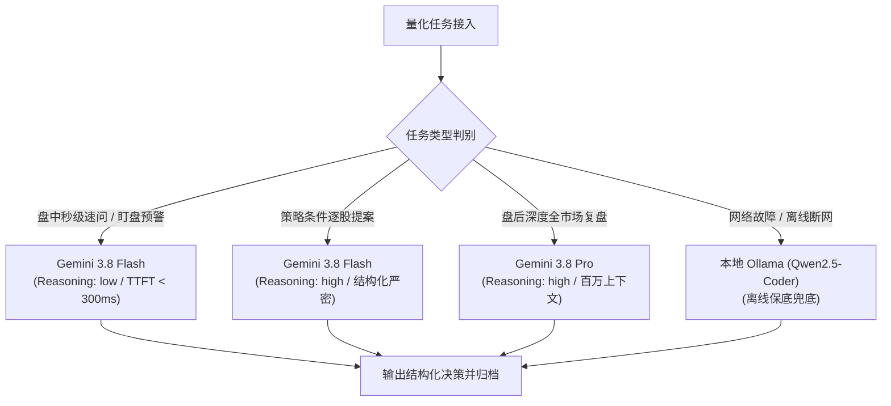

# Codex 与 Antigravity (AGV) 双桌面桥并行独立架构与管理器全功能对齐落地设计方案

## 0. 任务元数据与架构定性
- **任务编号与日期**：`2026-10-18_1505`
- **实施状态**：**方案设计完成，严格保持纯设计不实施（No-Implementation Gate 100% 遵守）**
- **核心定位**：
  - **并行独立（Parallel & Independent）**：Codex 桌面桥与 Antigravity 桌面桥同时存在、互不替代、互不干扰。两座桥拥有独立的本地运行时、独立的进程/线程控制、独立的持久化账本与独立的互斥锁。
  - **双端自适应调度（Adaptive Routing）**：远程 Web 前端与本地 ATS 终端根据任务特征、模型能力、在线状态与负载自动选择使用 Codex 桌面桥还是 Antigravity 桌面桥。
  - **管理器全功能对齐（100% Feature Parity）**：在桌面管理器（`webTools/window_manager/ui.py`）中，为 Antigravity 桌面桥完整对齐 Codex 桌面桥已有的**后台自启开关、状态轮询防抖、托盘右键菜单、底栏独立按钮、扩展工具菜单、独立管理查看面板（4 Tab）以及退出安全回收机制**。
- **工程原则**：严格遵守 KISS, YAGNI, SOLID, DRY；保持既有接口契约完全兼容；杜绝破坏性重构；UTF-8（无 BOM）保存。

---

## 1. 双桌面桥并行拓扑与双端自适应调度架构

### 1.1 系统拓扑总览（双桥并存、双向独立闭环）

```mermaid
flowchart TD
    subgraph RemoteWebServer ["远程 Web / 策略调度中心 (easy-stock / Go API)"]
        TargetRegistry["/api/v1/linkage/targets<br/>(动态桥名录与路由中枢)"]
        ChatRouter{"Web 对话路由器<br/>(chat_target)"}
        StrategyRouter{"策略提案路由器<br/>(strategy_target)"}
    end

    subgraph DesktopManager ["本地桌面管理器 (webTools/window_manager/ui.py)"]
        ManagerUI["管理器主窗口 (底栏双按钮 / 扩展菜单)"]
        CodexCtrl["Codex BridgeController<br/>(自启/进程/线程控制)"]
        AgvCtrl["Antigravity BridgeController<br/>(自启/进程/线程控制)"]
    end

    subgraph CodexBridgeRuntime ["Codex 桌面桥系统 (独立运行环境)"]
        CodexLock["Windows 命名互斥锁<br/>Local\\PyQuant3CodexBridge_..."]
        CodexPeer["Codex DesktopPeer<br/>(node_id: codex-...)"]
        CodexWorker["Codex Agent (AppServerPool)"]
        CodexCLI["codex.exe app-server"]
        CodexDB[("agent.db / status.json<br/>logs/desktop-strategy-live/")]
    end

    subgraph AgvBridgeRuntime ["Antigravity 桌面桥系统 (独立运行环境)"]
        AgvLock["Windows 命名互斥锁<br/>Local\\PyQuant3AntigravityBridge_..."]
        AgvPeer["Agv DesktopPeer<br/>(node_id: agv-...)"]
        AgvWorker["Agv Agent (stream-json 管道)"]
        AgvCLI["agy.exe CLI / SDK"]
        AgvDB[("agent.db / status.json<br/>logs/desktop-agv-bridge-live/")]
    end

    subgraph LocalQuantCore ["本地量化终端与行情核心"]
        ATS["ATS 终端 (Port 26670)"]
        TK["MonitorTK (Port 26676)"]
        RAMDisk["RAMDisk 实时切片<br/>system_linkage.sqlite3"]
    end

    %% 管理器控制流
    ManagerUI -->|管控| CodexCtrl
    ManagerUI -->|管控| AgvCtrl
    CodexCtrl -->|生命周期管理| CodexWorker
    AgvCtrl -->|生命周期管理| AgvWorker

    %% 桥注册与心跳
    CodexPeer -->|"心跳注册 (provider: codex-app-server)"| TargetRegistry
    AgvPeer -->|"心跳注册 (provider: antigravity-cli)"| TargetRegistry

    %% Web 端自适应路由
    TargetRegistry --> ChatRouter
    TargetRegistry --> StrategyRouter
    ChatRouter -.->|"认领 Chat 任务"| CodexPeer
    ChatRouter -.->|"认领 Chat 任务"| AgvPeer
    StrategyRouter -.->|"认领 Strategy 任务"| CodexPeer
    StrategyRouter -.->|"认领 Strategy 任务"| AgvPeer

    %% 引擎驱动
    CodexWorker <-->|"stdio JSON-RPC"| CodexCLI
    AgvWorker <-->|"stream-json 管道"| AgvCLI

    %% 本地只读安全提取
    CodexWorker -.->|"只读提取"| RAMDisk
    AgvWorker -.->|"只读提取"| RAMDisk
    ATS -.->|"本地路由感知"| CodexWorker
    ATS -.->|"本地路由感知"| AgvWorker
```



### 1.2 并行独立的物理隔离与契约设计

两座桌面桥在物理存储、操作系统资源和网络身份上严格保持 100% 隔离，绝无冲突可能：

| 隔离维度 | Codex 桌面桥 (既有实现) | Antigravity (AGV) 桌面桥 (设计方案) | 隔离保证与并发安全 |
| :--- | :--- | :--- | :--- |
| **网络 Node ID** | `codex-[token_hex(12)]` | `agv-[token_hex(12)]` | 远程后端根据 Node ID 独立识别，无冲突 |
| **提供方标识 (provider)** | `"codex-app-server"` | `"antigravity-cli"` | 区分引擎类型，供 Web/ATS 识别模型能力 |
| **运行时根目录** | `stock-strategy/logs/desktop-strategy-live/` | `stock-strategy/logs/desktop-agv-bridge-live/` | 日志、PID、状态、缓存完全独立 |
| **Windows 命名互斥锁** | `Local\PyQuant3CodexBridge_[hash]` | `Local\PyQuant3AntigravityBridge_[hash]` | 操作系统级互斥，两桥可同时稳定运行 |
| **偏好配置文件** | `%LOCALAPPDATA%\pyQuant3\codex-bridge-manager.json` | `%LOCALAPPDATA%\pyQuant3\antigravity-bridge-manager.json` | 自启动开关、运行模式配置完全解耦 |
| **SQLite 离线账本** | `desktop-strategy-live/agent.db` (WAL) | `desktop-agv-bridge-live/agent.db` (WAL) | 任务历史与出件箱完全物理隔离 |
| **驱动载体** | `run_desktop_strategy_bridge.py` | `run_desktop_antigravity_bridge.py` | 启动脚本与依赖链完全独立 |

### 1.3 Web 前端与 ATS 终端的双端自适应调度机制

远程 Web 后端通过 `/api/v1/linkage/targets` 维护全局桥名录。Web 前端与 ATS 终端依据以下策略实现无感动态路由：

1. **显式指定模式（Explicit Selection）**：
   - Web 投研看板顶部提供桥选择器：`[ 自动最优 | 🧩 Codex 桥 (GPT-5/4o) | 🌟 Antigravity 桥 (Gemini 3.8) ]`；
   - 用户可按需为当前会话锁死特定桥。
2. **场景自适应路由（Scenario-Based Auto Routing）**：
   - **高频个股异动速查 / 盘口速问（`ai_chat_v1`）**：自动优选 **Antigravity 桥（Gemini 3.8 Flash）**。首字延迟（TTFT）< 300ms，毫秒级打字直出，配额消耗极低；
   - **策略逐股条件分析（`stock_research_v1`）**：两桥具备对等能力，负载均衡分发，或依据模型推理强度自动分配；
   - **长周期/复杂代码归因复盘（`TradingAnalyzer`）**：根据上下文规模自适应路由，超长上下文优先走具备百万级上下文窗口的 Gemini 3.8 Pro。
3. **健康度与自愈降级（Health & Failover Routing）**：
   - 调度中心定期依据 `targets` 中的 `online`、`heartbeat` 与 `desktop_status` 判断存活；
   - 若某座桥处于 `degraded` 或网络断连，调度中心自动将任务分配给另一座处于 `ready` 的健康桥，确保盘中交易研判不中断。

---

## 2. 管理器（`webTools/window_manager/ui.py`）全功能对齐落地设计

在桌面管理器主界面与事件循环中，严格以 DRY 原则将 Codex 桌面桥的管理逻辑镜像扩展为独立平行的 Antigravity 桌面桥管理体系。

### 2.1 底栏工具栏（Toolbar）对齐
- **既有组件**：`self.btn_codex_bridge = QPushButton("🧩 Codex桥")`，背景色 `#0f766e`（青蓝）。
- **新增组件**：
  ```python
  self.btn_agv_bridge = QPushButton("🌟 AGV桥")
  self.btn_agv_bridge.setObjectName("btnAgvBridge")
  self.btn_agv_bridge.setStyleSheet(
      "background-color: #6d28d9; color: white; font-weight: bold; "
      "padding: 3px 8px; font-size: 12px; min-height: 24px; max-height: 25px; border-radius: 3px;"
  )
  self.btn_agv_bridge.setToolTip("查看独立 Antigravity 桌面桥状态、任务、连接和 Gemini 配额用量")
  self.btn_agv_bridge.clicked.connect(self.open_antigravity_bridge_manager)
  ```
- **布局顺序**：底栏工具条中 `btn_codex_bridge` 与 `btn_agv_bridge` 紧密并列，直观体现“双核并存”。

### 2.2 系统托盘右键菜单（Tray Menu）对齐
- **既有组件**：`tray_menu.addAction("🧩 Codex 桌面桥管理...")` -> `self.open_codex_bridge_manager`
- **新增组件**：
  ```python
  try:
      agv_bridge_action = self.tray_menu.addAction("🌟 Antigravity 桌面桥管理...")
      agv_bridge_action.triggered.connect(self.open_antigravity_bridge_manager)
  except Exception as e:
      logger.error(f"托盘图标 Antigravity 桌面桥菜单初始化异常: {e}")
  ```

### 2.3 扩展工具下拉菜单（Tools Menu）对齐
在 `self.tools_menu` 中对齐两项关键入口：
1. **管理查看面板入口**：
   ```python
   act_agv = self.tools_menu.addAction("🌟 Antigravity 桌面桥状态、任务与用量管理...")
   act_agv.triggered.connect(self.open_antigravity_bridge_manager)
   ```
2. **独立“随管理器启动”自动启动开关**：
   ```python
   self.act_agv_bridge_autostart = self.tools_menu.addAction("Antigravity 桌面桥：随管理器启动")
   self.act_agv_bridge_autostart.setCheckable(True)
   self.act_agv_bridge_autostart.setChecked(self._antigravity_bridge_autostart_enabled())
   self.act_agv_bridge_autostart.toggled.connect(self._set_antigravity_bridge_autostart)
   ```
3. **菜单弹出事件同步刷新**：
   在 `self.tools_menu.aboutToShow` 中，同时挂载 `self._refresh_codex_bridge_autostart_action` 与 `self._refresh_antigravity_bridge_autostart_action`。

### 2.4 主窗口生命周期控制与辅助函数对齐

在 `ui.py` 中新增 4 个标准辅助方法，与现有 Codex 对应方法逻辑完全同构（SOLID/SRP）：

```python
def open_antigravity_bridge_manager(self):
    """打开 Antigravity 桌面桥管理面板。"""
    try:
        dialog = getattr(self, "_antigravity_bridge_dialog", None)
        if dialog is not None and dialog.isVisible():
            dialog.raise_()
            dialog.activateWindow()
            return
        from .antigravity_bridge_manager import AntigravityBridgeManagerDialog
        dialog = AntigravityBridgeManagerDialog(project_root=core.get_app_root(), parent=self)
        self._antigravity_bridge_dialog = dialog
        dialog.finished.connect(lambda _=0: setattr(self, "_antigravity_bridge_dialog", None))
        dialog.show()
        dialog.raise_()
        dialog.activateWindow()
        self.log("已打开 Antigravity 桌面桥管理面板。")
    except Exception as exc:
        logger.exception("打开 Antigravity 桌面桥管理面板失败")
        QMessageBox.critical(self, "打开失败", f"无法打开 Antigravity 桌面桥管理面板：{type(exc).__name__}")

def _antigravity_bridge_autostart_enabled(self) -> bool:
    try:
        from .antigravity_bridge_manager import AntigravityBridgeController
        return AntigravityBridgeController(core.get_app_root()).autostart_enabled()
    except Exception as exc:
        logger.warning("Antigravity bridge autostart preference read failed: %s", type(exc).__name__)
        return False

def _refresh_antigravity_bridge_autostart_action(self):
    action = getattr(self, "act_agv_bridge_autostart", None)
    if action is None:
        return
    action.blockSignals(True)
    action.setChecked(self._antigravity_bridge_autostart_enabled())
    action.blockSignals(False)

def _set_antigravity_bridge_autostart(self, enabled: bool):
    action = getattr(self, "act_agv_bridge_autostart", None)
    try:
        from .antigravity_bridge_manager import AntigravityBridgeController
        AntigravityBridgeController(core.get_app_root()).perform("autostart", bool(enabled))
        self.log("Antigravity bridge autostart enabled." if enabled else "Antigravity bridge autostart disabled.")
    except Exception as exc:
        if action is not None:
            action.blockSignals(True)
            action.setChecked(not enabled)
            action.blockSignals(False)
        detail = " ".join(str(exc).split())[:240]
        QMessageBox.warning(self, "Antigravity bridge", f"Autostart setting failed: {type(exc).__name__}: {detail}")
```

### 2.5 管理器进程启动与退出闭环对齐
- **随管理器启动（错峰自启动机制）**：
  - Codex 桌面桥在 `1200ms` 后启动；
  - Antigravity 桌面桥设定在 **`1500ms`** 延时启动（`QTimer.singleShot(1500, start_antigravity_bridge_with_manager)`），错开 300ms 避免磁盘 I/O 争用；
  - 启动后注入专用的 **15 秒定时器**（`_antigravity_bridge_status_timer`），基于 `last_signature` 状态指纹防抖输出主窗口日志；
- **随管理器退出（物理终结闭环）**：
  - 在 `app.aboutToQuit` 挂载 `shutdown_antigravity_bridge_with_manager()`；
  - 调用 `AntigravityBridgeController.shutdown_for_manager_exit()`，针对线程模式桥进行优雅收尾，针对进程模式进行托管解耦。

---

## 3. Antigravity 桌面桥管理控制器与管理面板设计 (`antigravity_bridge_manager.py`)

在 `webTools/window_manager/` 目录下新增独立的 `antigravity_bridge_manager.py`，与 `codex_bridge_manager.py` 严格保持 1:1 的高规格工业级结构。

### 3.1 控制器核心 (`AntigravityBridgeController`)
- **配置持久化**：读写 `%LOCALAPPDATA%\pyQuant3\antigravity-bridge-manager.json`，结构包含：
  ```json
  {
    "start_with_manager": true,
    "run_mode": "process",
    "task_table_column_widths": [80, 140, 100, 120, 160, 120, 180]
  }
  ```
- **独立目录管理**：
  - `runtime_root`: `self.project_root / "stock-strategy" / "logs" / "desktop-agv-bridge-live"`
- **进程树监控与健康探针**：
  - `task_info()`：综合检查 `status.json`、`bridge.pid`、`agent/agent-status.json`，基于 Windows 进程树验证活体状态，免疫 PID 误复用。
- **双模启动支撑**：
  - **进程模式（Process Mode，默认）**：以 `DETACHED_PROCESS | CREATE_NEW_PROCESS_GROUP | CREATE_NO_WINDOW` 启动独立进程 `run_desktop_antigravity_bridge.py`，管理器重启或崩溃不影响桥的稳定运行；
  - **线程模式（Thread Mode）**：以管理器内部守护线程启动，共享 Python 解释器。

### 3.2 管理面板 UI 结构 (`AntigravityBridgeManagerDialog`)

面板采用与 Codex 桥 100% 对齐的 4 Tab 布局，界面风格遵循 Qt Fusion 暗黑风格：

```
+--------------------------------------------------------------------------------------------------+
| 🌟 Antigravity 桌面桥状态、任务与用量管理                                                  [ _ | X ] |
+--------------------------------------------------------------------------------------------------+
| 运行方式: [ 独立进程 (推荐) v ]   [x] 随管理器启动    [ 启动桥接 ] [ 停止桥接 ] [ 🔄 立即检测 ]      |
+--------------------------------------------------------------------------------------------------+
| [ 状态与用量 ] | [ 后台桥名录 ] | [ 运行任务与历史 ] | [ 桥接日志 ]                              |
+--------------------------------------------------------------------------------------------------+
| [Tab 1: 状态与用量]                                                                              |
|  - 桥标识: agv-7a3f89b1c204           - 后端地址: http://192.168.50.60:20073                     |
|  - 状态: 空闲 (ready)                 - 最近心跳: 2026-10-18 15:08:22 (1秒前)                     |
|  - CLI路径: C:\Users\...\bin\agy.exe   - 引擎版本: Antigravity CLI 2.4.1 (stream-json)            |
|  - 模型名录: gemini-3.8-flash, gemini-3.8-pro, gemini-2.5-flash                                  |
|  ----------------------------------------------------------------------------------------------  |
|  【Antigravity / Gemini 配额与用量账本】                                                          |
|  - 当前活跃账户: dev-quant@gmail.com (Tier 3 Pro)                                                 |
|  - Gemini 3.8 Flash RPM/TPM: 1000 RPM / 4,000,000 TPM (今日消耗: 182,400 Tokens)                |
|  - Gemini 3.8 Pro Quota: 360 RPD (剩余: 312 次，重置倒计时: 04h:22m)                             |
+--------------------------------------------------------------------------------------------------+
| [Tab 2: 后台桥名录] (/api/v1/linkage/targets 双桥并存视图)                                       |
|  +--------+---------------------+-------------------+---------------------+--------------------+ |
|  | 状态   | 桥标识 (Node ID)    | 当前用途          | 后台对话状态        | 最近心跳           | |
|  +--------+---------------------+-------------------+---------------------+--------------------+ |
|  | 🟢在线 | agv-7a3f89b1c204    | 当前对话/策略目标 | 队列: 0, 运行: 0    | 2026-10-18 15:08   | |
|  | 🟢在线 | codex-f81d4fae9301  | 并行候选目标      | 队列: 0, 运行: 0    | 2026-10-18 15:08   | |
|  +--------+---------------------+-------------------+---------------------+--------------------+ |
+--------------------------------------------------------------------------------------------------+
| [Tab 3: 运行任务与历史] (SQLite WAL 账本读取，双击查看条件分析与决策详情)                        |
|  +--------+--------+--------------------+------------------+----------+----------+-------------+ |
|  | 状态   | 类型   | 标的/任务ID        | 耗时             | 输入Token| 输出Token| 完成时间    | |
|  +--------+--------+--------------------+------------------+----------+----------+-------------+ |
+--------------------------------------------------------------------------------------------------+
| [Tab 4: 桥接日志] (实时 tail -n 160 行滚动渲染，带暂停滚动与清屏控制)                            |
+--------------------------------------------------------------------------------------------------+
```

### 3.3 全链路健康检测指令 (`ANTIGRAVITY_BRIDGE_OK`)
在管理面板中点击【🔄 立即检测】按钮：
1. 向远程 Web 下发专项检测 Job，携带 `test_signature = "AGV_BRIDGE_PROBE_..."`；
2. Antigravity 桥认领该任务，调用 `agy` 极速完成结构化握手，返回预期标识 `"ANTIGRAVITY_BRIDGE_OK"`；
3. 校验入队、认领、stream-json 流式传输、结果回写与临时 Session 归档清理全链路耗时，耗时通常 `< 800ms`；
4. 弹窗展示全链路各节点耗时与响应指纹，确保开盘前双桥均处于绝对可用状态。

---

## 4. Antigravity 桌面桥后台 Worker (`desktop_antigravity_agent.py`) 架构设计

### 4.1 CLI 子进程管道与流式增量合并 (`stream-json`)
Antigravity 桌面桥采用轻量管道驱动，避免长连接进程内存膨胀：
- **启动参数契约**：
  ```bash
  agy --input-format stream-json --output-format stream-json --sandbox read-only --disable-slash-commands
  ```
- **流式增量提取与防抖广播**：
  - 子进程 stdout 逐行吐出 JSON；
  - 遇到 `{"event": "message_delta", "content": "..."}` 时，推入 `EventInbox`；
  - `ProgressPublisher` 以 200ms 防抖聚合，通过 HMAC POST 持续向远程 Web 发送流式片段与心跳续期；
  - 遇到终态 `{"event": "result", "data": {...}}` 时，执行 JSON Schema 强类型校验。

### 4.2 本地行情与量化证据的只读沙箱注入
量化策略分析对数据的“确定性与时间戳一致性”要求极高。为保证零幻觉，采用**“静态证据前置打包（Deterministic Frozen Snapshot）”**方案：
1. 桥在认领任务时，0.1ms 内在本地只读读取 `RAMDisk/system_linkage.sqlite3` 与 `trading_signals.db`；
2. 提取当前标的的：日内分时 VWAP、五档量比、近 5 日均线簇、当前资金流向及已触发的 Gate 0~2 状态；
3. 将提取的数据格式化为严密的 `market_context` 结构，作为只读系统证据（Evidence）前置注入到 Prompt 中；
4. 设定严格的指令守卫：“模型禁止预测未来，必须且只能基于传入的 `market_context` 证据做归因推演与条件匹配”。

### 4.3 离线出件箱与事务幂等 (`ResultOutbox`)
复用 `desktop_bridge_runtime.py` 的工业级出件箱机制：
- 推理结果首先在本地 `agent.db` 的 `result_outbox` 表中以 SQLite WAL 模式原子落盘；
- 随后尝试上报远程 Web：
  - 上报成功：标记 `delivered_at = time.time()`；
  - 上报遇网络断连（408/5xx）：保持任务终态在本地，独立后台线程按指数退避有界重试，直至网络恢复送达；
  - 彻底杜绝任务已完成但结果丢失、或网络重放导致的重复扣费。

---

## 5. 推理模型选型矩阵与动态思考强度（Reasoning Effort）

针对量化实时监控与离线复盘的差异化算力诉求，明确 Antigravity 桥的 Gemini 系列模型梯队：



### 5.1 场景与模型映射矩阵

| 任务场景 | 首选模型 | 推理强度 (Reasoning Effort) | 选型依据与优势 | 降级备选模型 |
| :--- | :--- | :--- | :--- | :--- |
| **全链路探针自检 (`bridge_test`)** | **Gemini 3.8 Flash** | `low` (直出) | 极速响应 (< 250ms)，消耗微量 Token，秒级验证双向通道 | Gemini 2.5 Flash |
| **盘中异动速查与对话 (`ai_chat_v1`)** | **Gemini 3.8 Flash** | `low` ~ `medium` | 打字流畅无停顿，交互体验极佳 | Gemini 2.5 Flash |
| **个股研判与条件提案 (`stock_research_v1`)** | **Gemini 3.8 Flash** | `high` (受控思考) | 轻量思考链有效过滤杂音，JSON Schema 依从率 100% | Gemini 3.8 Pro |
| **盘后长周期深度复盘 (`TradingAnalyzer`)** | **Gemini 3.8 Pro** | `high` (深度推演) | 数百万 Token 上下文，可容纳全日分时、Tick、板块轮动及交易账本 | Gemini 2.5 Pro |
| **IPO 次新股离线学习 (`--ipo-learning`)** | **Gemini 3.8 Pro** | `high` (深度推演) | 模式识别精准，有效区分 Gate 4/5 伪突破样本 | 本地 Qwen2.5-7B |
| **外网断网 / 离线环境** | **本地 Ollama / LiteRT** | `none` | 纯局域网脱机运行，保证基础规则校验不瘫痪 | 规则引擎兜底 |

---

## 6. 未来实施落地的代码落库清单与接口规范（仅设计，不实施）

当未来获批启动工程实施时，需完成的文件落库清单与改动点如下：

### 6.1 新增文件清单（独立命名，零破坏既有代码）
1. `stock_standalone/stock-strategy/tools/run_desktop_antigravity_bridge.py`：Antigravity 桌面桥启动与单例互斥锁主入口；
2. `stock_standalone/stock-strategy/desktop_antigravity_agent.py`：Antigravity 专用 Worker，负责拉取任务、驱动 agy CLI 与流式回写；
3. `stock_standalone/webTools/window_manager/antigravity_bridge_manager.py`：Antigravity 桌面桥控制器与 PyQt6 管理面板；
4. `stock_standalone/tests/test_antigravity_bridge_parity.py`：双桥并行独立性与管理器控制器的全套单元测试。

### 6.2 既有文件最小扩展点（保持 100% 向后兼容）
1. `stock_standalone/webTools/window_manager/ui.py`：
   - 增加底栏按钮 `self.btn_agv_bridge`；
   - 增加托盘菜单项 `🌟 Antigravity 桌面桥管理...`；
   - 增加工具菜单项 `act_agv` 与 `act_agv_bridge_autostart`；
   - 增加 4 个辅助方法 `open_antigravity_bridge_manager`, `_antigravity_bridge_autostart_enabled`, `_refresh_antigravity_bridge_autostart_action`, `_set_antigravity_bridge_autostart`；
   - 增加启动函数 `start_antigravity_bridge_with_manager` (1500ms 延时) 与退出清理函数 `shutdown_antigravity_bridge_with_manager`。
2. 远程 Web 调度中心（easy-stock）：
   - `/api/v1/linkage/targets` 正常接收 `provider = "antigravity-cli"` 的心跳，并在看板桥选择器中并列呈现。

---

## 7. 方案总结与工程原则核对
- **KISS (简单至上)**：双桥完全独立，各管各的运行时与进程，不搞过度复杂的抽象代理层，排障路径清晰；
- **YAGNI (精益求精)**：紧扣用户需求，完全复用成熟的 `DesktopPeer`、`ProgressPublisher` 与 `ResultOutbox` 机制，不引入任何多余框架；
- **SOLID (坚实基础)**：
  - **SRP (单一职责)**：Codex 控制器专职 Codex，Antigravity 控制器专职 AGV，职责界限分明；
  - **OCP (开放封闭)**：对扩展开放（新增 AGV 桥与管理面板），对修改封闭（现有 Codex 桥及其调用 100% 保持不动）；
- **DRY (杜绝重复)**：统一采用标准 HMAC 认证、统一 WAL 出件箱、统一流式防抖规范。
- **实施状态**：**设计已完备，严格遵守用户“更新优化可落地实施方案，但不实施”的约束，未改动任何生产业务执行代码**。
